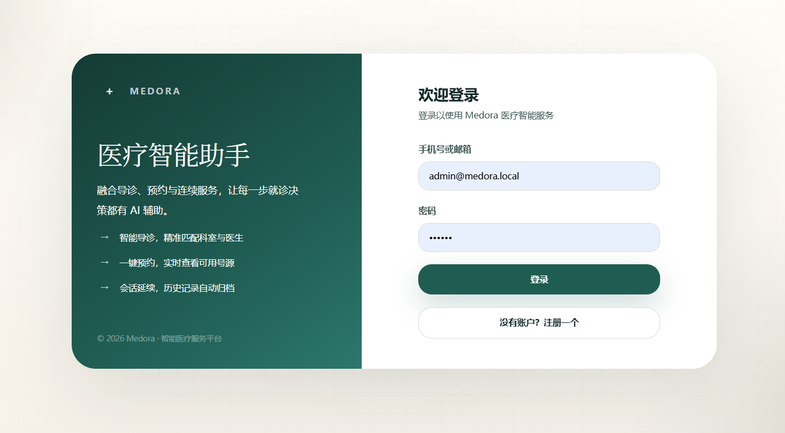
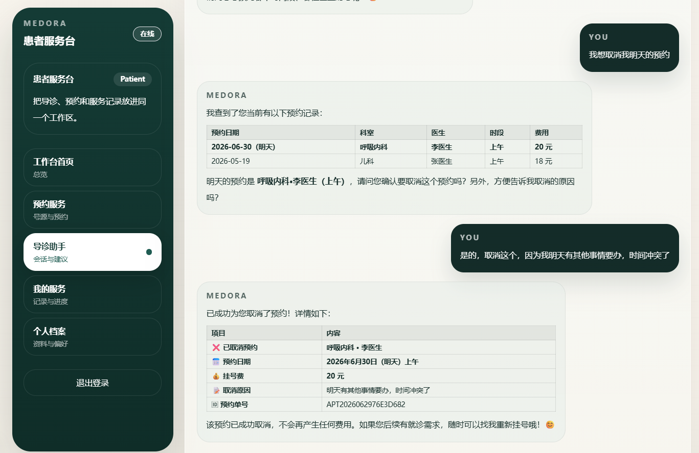
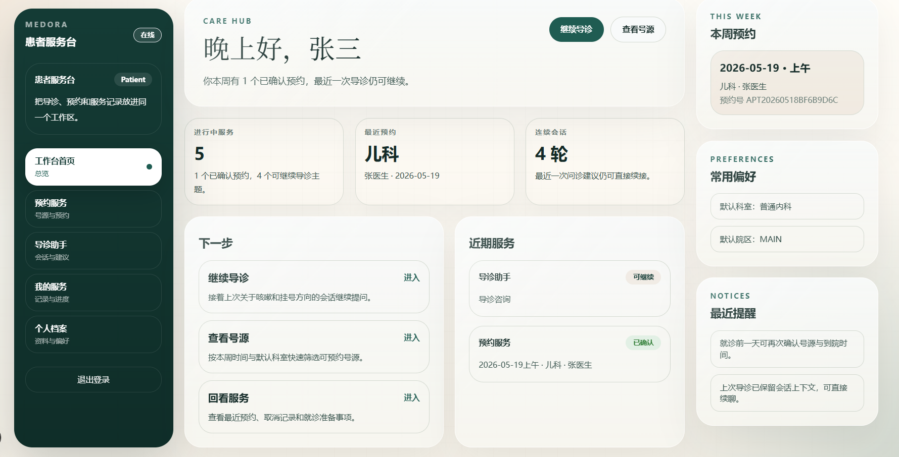
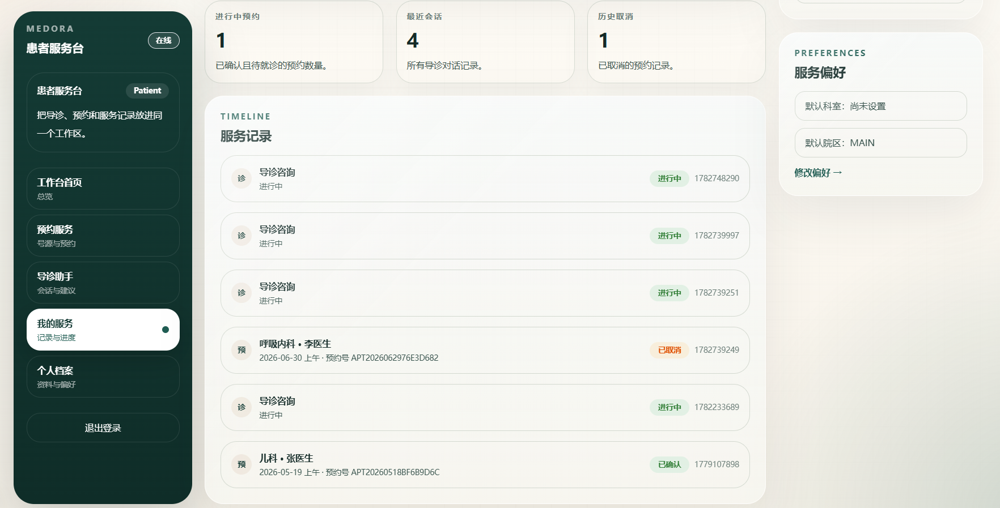
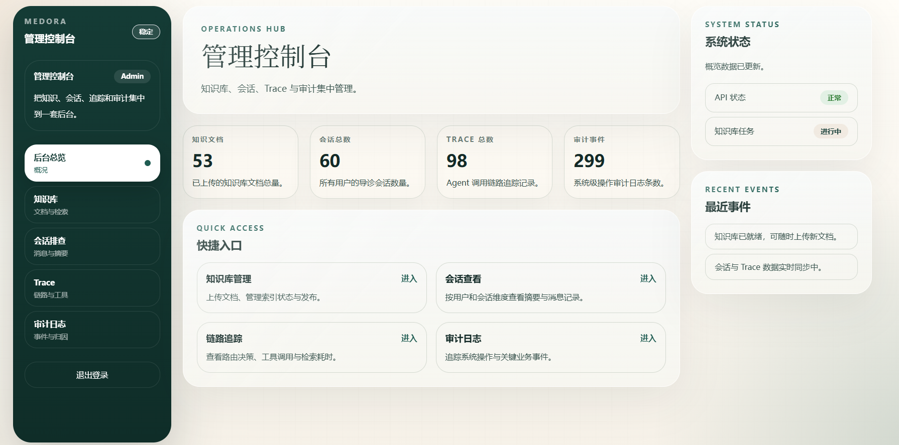

# Medora

> 面向医疗服务的工程化智能助手系统 — 多 Agent 架构 + LLM 评测平台 + RAG 知识库 + 全栈可观测

Medora 覆盖导诊咨询、科室/医生/号源查询、预约挂号与取消、知识库 RAG 问答、会话记忆与后台排障能力。项目基于 Google ADK 构建多 Agent 编排,自建 LLM 评测平台与 CI 回归,坚持 LLM-first 原则与四层医疗安全防护。

## 界面展示

### 患者端

| 页面 | 截图 |
|---|---|
| 登录入口 |  |
| AI 助手对话(SSE 流式 + Markdown 渲染) |  |
| 会话详情(患者画像 + 最近预约 + 偏好记忆) |  |
| 数据记录与偏好设置 |  |

### 管理后台

| 页面 | 截图 |
|---|---|
| 管理控制台(知识文档 / 会话 / Trace / 审计 概览) |  |

## 核心亮点

- **基于 Google ADK 构建多 Agent 编排架构** — 配置 Root、Triage、Booking、Knowledge 四 Agent 拓扑,通过 LLM 路由与 transfer 实现意图分发;落地分层安全 Callback、工具桥接与会话持久化,完成旧过程式编排的全量替换。

- **LLM 评测与 CI 回归平台** — 自建测试用例、评分器、执行器三层框架,支持 LLM 自动评分、对抗用例生成;测试用例随代码版本管理,PR 提交时 GitHub 自动跑回归测试,LLM 行为退化立即报警。

- **分层 RAG 知识问答** — 基于 PostgreSQL、pgvector 构建父子块索引，组合向量、关键词、元数据过滤和可选重排；确定性离线基线见 [RAG 评测报告](docs/reports/rag-evaluation.md)，不将该基线表述为线上准确率。

- **多层级会话记忆** — Redis 短期缓存、PostgreSQL 长期记忆和摘要压缩组成动态 Context Builder，并通过相关性、时效、画像一致性筛选和指纹去重控制上下文；效果见 [Context 效率报告](docs/reports/context-efficiency.md)。

- **医疗合规与可观测** — 坚持 LLM-first(决策层不降级到正则),落地 prompt 注入、越权请求、处方建议、幻觉检测四层防护;Agent Trace 持久化路由链、工具事件、检索结果、延迟、风险等级,支持按 traceId 排障。

## 技术栈

| 层 | 选型 |
|---|---|
| 后端 | Spring Boot 3 · Java 21 · Maven 3.9+ |
| 数据 | PostgreSQL · pgvector · Redis |
| AI | Google ADK 0.3 · LangChain4j · DeepSeek · Anthropic |
| 前端 | Next.js 15 · React 19 · TypeScript 5.6 · Tailwind 3.4 · Node.js 22 |
| 评测 | EvalCli(自研)· JUnit 5 · GitHub Actions |

## 系统架构

[A 阶段架构总览](docs/architecture/a-stage-overview.md) 给出多 Agent、Context Builder、分层 RAG、预约一致性和 Tool Gateway/MCP 的实现边界；三个关键时序见 [Context](docs/architecture/context-sequence.md)、[RAG](docs/architecture/rag-sequence.md) 与 [预约/候补](docs/architecture/appointment-sequence.md)。

## 快速开始（macOS/Linux）

### 1. 环境与配置

需要 Docker Desktop、JDK 21、Maven 3.9+、Node.js 22 和 npm。先确认版本并安装前端锁定依赖：

```bash
java -version
mvn -version
cd frontend && npm ci && cd ..
```

创建本地配置；`.env` 已被 Git 忽略：

```bash
cp .env.example .env
```

必须由你填写或确认的字段：

- 真实聊天演示：`AI_CHAT_PROVIDER=openai-compatible`、`AI_CHAT_API_KEY`、`AI_CHAT_BASE_URL`、`AI_CHAT_MODEL`。
- 本地认证：把 `JWT_SECRET` 改为至少 32 位随机值。
- 若修改默认数据库、MinIO 或 MCP 凭据，同步修改对应的 `DB_*`、`MINIO_*`、`HOSPITAL_DIRECTORY_MCP_TOKEN`。

只跑基础设施、测试、seed 和离线报告时可以保留 `AI_CHAT_PROVIDER=local` 与占位 API key。不要提交 `.env` 或任何真实密钥。启动前将配置导出给 Maven 和脚本：

```bash
set -a
source .env
set +a
```

### 2. 按顺序启动

终端 1，启动 PostgreSQL + pgvector、Redis、MinIO 和演示 MCP：

```bash
docker compose -f deploy/compose/docker-compose.dev.yml up -d --build
docker compose -f deploy/compose/docker-compose.dev.yml ps
```

终端 2，启动后端（首次启动会执行 Flyway）：

```bash
set -a; source .env; set +a
cd backend
mvn spring-boot:run
```

后端健康后，在项目根目录装载可重复的纯合成演示数据；重复执行不会重复插入：

```bash
./scripts/seed-demo.sh
./scripts/test-seed-idempotency.sh
```

终端 3，启动前端：

```bash
set -a; source .env; set +a
cd frontend
npm run dev
```

### 3. 验证与演示

所有服务启动后执行一次有超时上限、不会输出 token/用户响应正文的 smoke：

```bash
./scripts/smoke-a-stage.sh
```

演示登录为 `demo.patient@medora.local` / `MedoraDemo!2026`；本机受控管理员为 `demo.admin@medora.local` / `MedoraAdmin!2026`（仅用于本机合成数据与 smoke 的 RAG 诊断验证）。三条演示路径见 [长对话](docs/demo/01-long-conversation.md)、[分层 RAG](docs/demo/02-layered-rag.md)、[A2UI 预约与候补](docs/demo/03-a2ui-waitlist.md)。生成可复现报告：

```bash
./scripts/generate-a-stage-reports.sh
```

最终验收记录见 [A 阶段验收清单](docs/a-stage-acceptance-checklist.md)。

### 跑评测

```bash
cd backend

# 模拟模式(无 LLM,验证流程)
mvn -B test-compile exec:java -Dexec.mainClass=com.medora.eval.EvalCli \
    -Dexec.classpathScope=test \
    '-Dexec.args=--mode stub --scenarios src/test/resources/eval/scenarios/demo-perfect.yaml'

# 回放模式(用入 git 的 recordings,CI 友好)
mvn -B test-compile exec:java -Dexec.mainClass=com.medora.eval.EvalCli \
    -Dexec.classpathScope=test \
    '-Dexec.args=--mode replay --recordings src/test/resources/eval/recordings/judge.json \
     --scenarios src/test/resources/eval/scenarios/demo-perfect.yaml'
```

## 项目结构

```text
Medora/
  backend/                    Spring Boot 后端
    src/main/java/com/medora/
      adk/                    Google ADK 多 Agent 编排(agents/orchestrator/guard/session/tool/sse)
      agent/                  Chat orchestrator + Trace
      ai/                     LLM / Embedding / RAG
      appointment/            预约业务
      auth/                   认证
      chat/                   会话与 SSE
      knowledge/              知识库与 RAG 检索
      masterdata/             科室/医生/号源
    src/test/java/com/medora/
      eval/                   LLM 评测平台(domain/loader/judge/runner/report/llm/gen)
  frontend/                   Next.js 前端
    app/app/                  患者端
    app/admin/                管理后台
    app/prototype/            高保真原型
  docs/                       阶段日志与补充文档
  design/                     设计文档与实施计划
  scripts/                    开发辅助脚本
  .github/workflows/          CI(eval stub + replay 双 job)
```

## 常用地址

- 后端健康检查:`http://localhost:8080/actuator/health`
- 前端首页:`http://localhost:3000`
- 患者端助手:`http://localhost:3000/app/assistant`
- 管理后台:`http://localhost:3000/admin`
- 高保真原型:`http://localhost:3000/prototype`

## 文档导航

- [优化方案与进度](./docs/optimization-plan.md)
- [系统总览](./system-overview.md)
- [阶段日志索引](./docs/README.md)
- [A 阶段架构总览](./docs/architecture/a-stage-overview.md)
- [A 阶段验收清单](./docs/a-stage-acceptance-checklist.md)
- [实施计划](./design/05-implementation-plan.md)
- [技术设计](./design/technical-design.md)
- [API 契约设计](./design/03-api-contract-design.md)
- [正式前端结构与视觉方案](./design/06-frontend-page-structure-and-visual-design.md)
