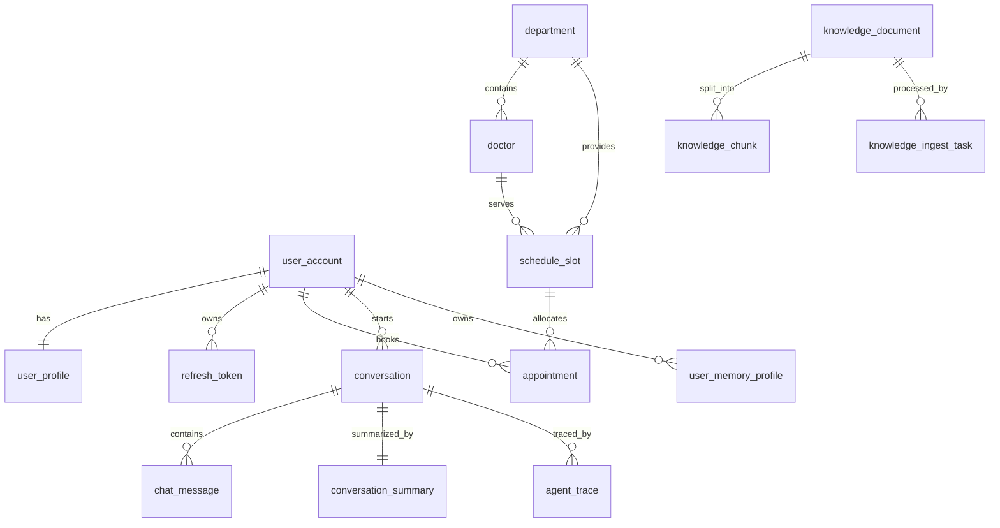
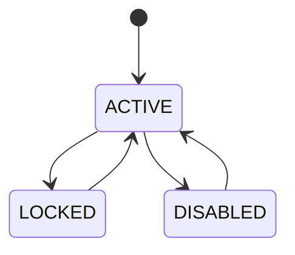
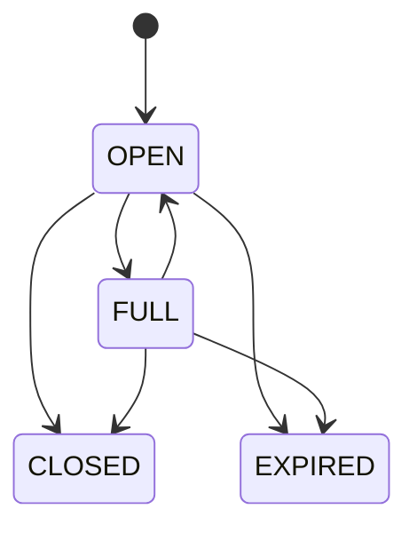
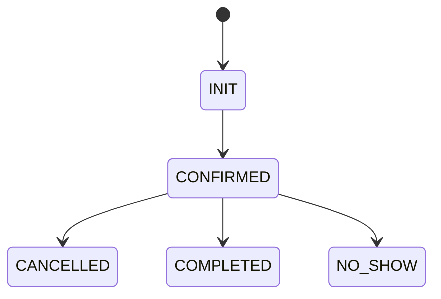
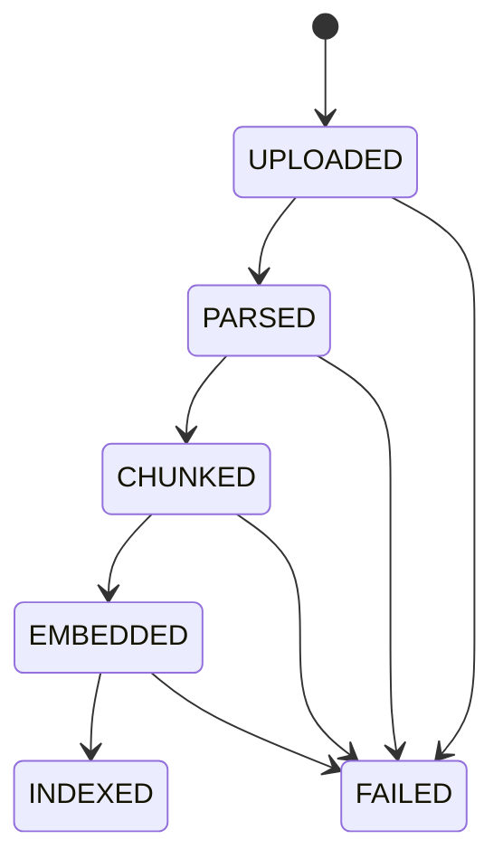

# 02. 领域模型与数据库详细设计

## 0. 文档定位
本文是对 [technical-design.md](/d:/BOS/Medora/design/technical-design.md) 中“数据库设计”“核心业务系统设计”“Agent 解耦设计”的进一步细化，目标是把总体设计补足到可直接指导以下工作的粒度：

- 设计数据库 migration
- 定义 JPA Entity / Repository
- 划分领域对象与聚合根
- 编写 Service 层事务逻辑
- 设计预约、取消、号源回补的一致性处理
- 为 API 设计与 Agent Tool 设计提供稳定数据边界

本文先聚焦一期 MVP 必需的数据域，保持与已确认路线一致：
- `PostgreSQL + pgvector + FTS`
- 模块化单体
- 单 Agent + Tool Calling
- 业务主流程优先于平台化复杂能力

---

## 1. 设计目标与约束

### 1.1 设计目标
- 建立清晰的领域边界，避免业务表、会话表、知识表混杂。
- 一期以“最小但完整”的模型支撑用户、挂号、取消、号源、会话、知识库、记忆、审计。
- 在保持实现简洁的前提下，为二期搜索引擎升级、独立 worker、更多业务规则预留空间。
- 尽量让所有关键业务操作都能在单库本地事务内完成，降低一致性复杂度。
- 数据结构要服务于 API、后台查询、Agent Tool 调用三类上层能力。

### 1.2 设计约束
- 一期不引入分布式事务。
- 一期不引入消息队列，但允许引入 `outbox` 表做后续异步扩展预留。
- 一期不使用 PostgreSQL 原生 `ENUM`，优先使用 `varchar(32)` + 约定状态码，避免迁移困难。
- 一期主键统一建议使用 `bigint` 自增主键，面向外部暴露的资源 ID 使用 `public_id` 或业务单号。
- 全部时间字段统一使用 `timestamptz`。
- 柔性结构字段优先使用 `jsonb`，但核心查询条件不能只埋在 `jsonb` 里。

### 1.3 合理工程假设
- 系统当前为单院区演示版，但模型中预留 `hospital_code` 或 `campus_code` 字段扩展位。
- 预约流程一期不接支付，因此预约状态不含支付中间态。
- “号源”一期按“时间槽”建模，不做真实医院复杂排班模板引擎。
- 一期导诊建议主要依赖知识库与科室信息，不引入结构化症状规则引擎。

---

## 2. 领域划分与聚合边界

### 2.1 一期核心领域划分
建议按以下子域组织代码和数据：

- 身份与用户域
  - 用户账号
  - 用户资料
  - 刷新令牌
  - 用户偏好与长期记忆

- 医疗服务业务域
  - 科室
  - 医生
  - 号源时间槽
  - 预约
  - 预约操作日志
  - 简化就诊记录

- 对话与 Agent 域
  - 会话
  - 消息
  - 会话摘要
  - Agent Trace

- 知识库与检索域
  - 知识文档
  - 知识切片
  - 入库任务

- 审计与系统域
  - 审计日志
  - 系统配置
  - Outbox 事件

### 2.2 聚合根建议
为保证事务边界清晰，建议一期按以下聚合根实现：

| 聚合根 | 说明 | 事务边界 |
|---|---|---|
| `UserAccount` | 用户身份与登录主体 | 注册、登录、状态变更 |
| `Department` | 科室主数据 | 后台维护、查询 |
| `Doctor` | 医生主数据 | 后台维护、查询 |
| `ScheduleSlot` | 号源库存核心对象 | 号源扣减、回补 |
| `Appointment` | 预约主单 | 创建、取消、状态流转 |
| `Conversation` | 会话容器 | 会话创建、消息归属 |
| `KnowledgeDocument` | 文档主对象 | 上传、发布、重建 |

### 2.3 聚合边界原则
- `Appointment` 与 `ScheduleSlot` 虽然业务强相关，但建议为两个独立聚合，通过本地事务协调。
- `Conversation` 不应直接拥有业务写操作；业务事实来自业务域，聊天域只记录表现层与推理轨迹。
- `KnowledgeDocument` 与 `KnowledgeChunk` 组成文档索引聚合，但切片写入可分批处理。
- `UserMemoryProfile` 不作为会话子表，而作为独立用户长期资产。

---

## 3. 核心领域对象与关系

### 3.1 概览关系图


### 3.2 用户域对象

#### `UserAccount`
- 代表系统登录主体
- 承载账号唯一性、账号状态、密码哈希
- 不承载大段展示信息

#### `UserProfile`
- 代表用户展示资料和业务偏好基础信息
- 与账号 `1:1`
- 建议保存默认就诊偏好，而不是把所有偏好都写到长期记忆表

#### `UserMemoryProfile`
- 用户长期记忆片段
- 保存稳定、可复用、已确认的信息
- 与会话摘要、消息表分离

### 3.3 医疗服务业务对象

#### `Department`
- 科室主数据
- 被导诊、医生筛选、挂号筛选复用

#### `Doctor`
- 医生主数据
- 从属于科室，但作为独立资源查询

#### `ScheduleSlot`
- 号源时间槽，是库存一致性核心对象
- 一条记录表示某医生在某日某时段的一类可预约资源
- 一期建议不要按“预约单行明细”倒推号源，避免并发逻辑复杂化

#### `Appointment`
- 用户预约单
- 一期只支持一个预约单对应一个号源槽
- 包含状态流转、取消信息、来源渠道

#### `AppointmentOperationLog`
- 预约相关操作日志
- 记录预约、取消、系统回补、后台修改等动作
- 用于问题排查和审计补充

### 3.4 对话与 Agent 对象

#### `Conversation`
- 对话容器
- 管理消息归属，不承担业务真相

#### `ChatMessage`
- 记录用户输入、模型输出、系统消息、工具消息
- 工具调用摘要与引用片段可放 `jsonb`

#### `ConversationSummary`
- 当前会话摘要
- 作为上下文压缩后的权威摘要载体

#### `AgentTrace`
- 一次模型编排的链路记录
- 记录意图、召回、工具使用、耗时

### 3.5 知识库对象

#### `KnowledgeDocument`
- 文档主对象
- 承载版本、来源、状态、发布可见性

#### `KnowledgeChunk`
- 检索切片对象
- 承载 FTS 文本、向量、检索元数据

#### `KnowledgeIngestTask`
- 文档入库任务
- 承载解析、切分、向量化等阶段状态

---

## 4. 数据库设计原则

### 4.1 命名与字段规范
- 表名统一使用 `snake_case`
- 主键统一 `id bigint generated by default as identity`
- 对外资源建议增加 `public_id uuid not null`
- 创建时间：`created_at timestamptz not null default now()`
- 更新时间：`updated_at timestamptz not null default now()`
- 状态字段统一 `varchar(32) not null`
- 柔性元数据使用 `jsonb`

### 4.2 建议的基础审计字段
除极少数纯关联表外，建议表中统一包含：
- `id`
- `public_id`
- `created_at`
- `updated_at`
- `created_by`
- `updated_by`
- `version`

其中：
- `version` 用于乐观锁
- `created_by`、`updated_by` 可为空，适用于系统任务或管理员操作

### 4.3 主键与外部标识策略
建议采用“双 ID”：
- 内部主键：`bigint`
- 外部资源标识：`uuid public_id`

原因：
- `bigint` 对 JPA、索引、连接性能友好
- `public_id` 对外暴露更安全，不暴露业务顺序

### 4.4 状态字段策略
不建议使用 PostgreSQL 原生枚举，原因：
- 迁移修改成本高
- 与 Java 代码版本配合不够灵活

推荐方案：
- `status varchar(32) not null`
- 应用层定义常量或枚举
- 必要时加 `check constraint`

---

## 5. 主要业务表设计

以下设计按“足够支持一期直接建表”的粒度展开。字段未列出的审计字段默认按第 4 章补齐。

## 5.1 用户与认证相关

### 5.1.1 `user_account`
**用途**
- 登录主体
- 鉴权归属

| 字段 | 类型 | 约束 | 说明 |
|---|---|---|---|
| id | bigint | PK | 内部主键 |
| public_id | uuid | UK | 对外资源标识 |
| username | varchar(64) | nullable | 用户名，演示版可选 |
| mobile | varchar(20) | UK nullable | 手机号 |
| email | varchar(128) | UK nullable | 邮箱 |
| password_hash | varchar(255) | not null | 密码哈希 |
| status | varchar(32) | not null | `ACTIVE/LOCKED/DISABLED` |
| register_source | varchar(32) | not null | `WEB/ADMIN/SEED` |
| last_login_at | timestamptz | nullable | 最近登录时间 |
| last_login_ip | varchar(64) | nullable | 最近登录 IP |
| version | integer | not null default 0 | 乐观锁 |
| created_at | timestamptz | not null | 创建时间 |
| updated_at | timestamptz | not null | 更新时间 |

**约束建议**
- `check (mobile is not null or email is not null)`

### 5.1.2 `user_profile`
**用途**
- 展示信息与基础业务偏好

| 字段 | 类型 | 约束 | 说明 |
|---|---|---|---|
| id | bigint | PK | 主键 |
| user_id | bigint | FK unique | 对应账号 |
| display_name | varchar(64) | not null | 展示名 |
| gender | varchar(16) | nullable | 性别 |
| birth_date | date | nullable | 生日 |
| default_hospital_code | varchar(32) | nullable | 预留院区 |
| default_department_id | bigint | nullable | 常用科室 |
| preference_json | jsonb | not null default '{}' | UI 偏好等 |
| created_at | timestamptz | not null | 创建时间 |
| updated_at | timestamptz | not null | 更新时间 |

### 5.1.3 `refresh_token`
**用途**
- 刷新令牌管理

| 字段 | 类型 | 约束 | 说明 |
|---|---|---|---|
| id | bigint | PK | 主键 |
| user_id | bigint | FK | 用户 |
| token_hash | varchar(255) | UK | 刷新 token 哈希 |
| status | varchar(32) | not null | `ACTIVE/REVOKED/EXPIRED` |
| expires_at | timestamptz | not null | 过期时间 |
| last_used_at | timestamptz | nullable | 最近使用时间 |
| created_at | timestamptz | not null | 创建时间 |

---

## 5.2 医疗服务主数据

### 5.2.1 `department`
| 字段 | 类型 | 约束 | 说明 |
|---|---|---|---|
| id | bigint | PK | 主键 |
| public_id | uuid | UK | 对外 ID |
| code | varchar(32) | UK | 科室编码 |
| name | varchar(64) | not null | 科室名称 |
| category | varchar(32) | nullable | 门诊类别 |
| description | text | nullable | 简介 |
| tags | text[] | nullable | 检索标签 |
| status | varchar(32) | not null | `ACTIVE/INACTIVE` |
| sort_order | integer | not null default 0 | 排序 |

### 5.2.2 `doctor`
| 字段 | 类型 | 约束 | 说明 |
|---|---|---|---|
| id | bigint | PK | 主键 |
| public_id | uuid | UK | 对外 ID |
| department_id | bigint | FK | 所属科室 |
| code | varchar(32) | UK nullable | 医生编码 |
| name | varchar(64) | not null | 医生姓名 |
| title | varchar(64) | nullable | 职称 |
| specialty | text | nullable | 擅长方向 |
| intro | text | nullable | 简介 |
| tags | text[] | nullable | 检索标签 |
| status | varchar(32) | not null | `ACTIVE/INACTIVE` |
| consultation_fee | numeric(10,2) | nullable | 挂号费用预留 |

---

## 5.3 号源与预约

### 5.3.1 `schedule_slot`
**用途**
- 号源库存控制核心表

| 字段 | 类型 | 约束 | 说明 |
|---|---|---|---|
| id | bigint | PK | 主键 |
| public_id | uuid | UK | 对外 ID |
| department_id | bigint | FK | 科室 |
| doctor_id | bigint | FK | 医生 |
| hospital_code | varchar(32) | nullable | 院区预留 |
| schedule_date | date | not null | 就诊日期 |
| period_code | varchar(32) | not null | `AM/PM/EVENING` |
| start_time | time | nullable | 开始时间 |
| end_time | time | nullable | 结束时间 |
| total_quota | integer | not null | 总号源 |
| available_quota | integer | not null | 剩余号源 |
| reserved_quota | integer | not null default 0 | 预留号源预留位 |
| fee | numeric(10,2) | not null default 0 | 挂号费用 |
| status | varchar(32) | not null | `OPEN/FULL/CLOSED/EXPIRED` |
| source_type | varchar(32) | not null default 'SYSTEM' | 来源 |
| version | integer | not null default 0 | 乐观锁 |
| created_at | timestamptz | not null | 创建时间 |
| updated_at | timestamptz | not null | 更新时间 |

**关键约束建议**
- `check (total_quota >= 0)`
- `check (available_quota >= 0)`
- `check (available_quota <= total_quota)`
- 唯一约束：`(doctor_id, schedule_date, period_code)`

### 5.3.2 `appointment`
**用途**
- 预约主单

| 字段 | 类型 | 约束 | 说明 |
|---|---|---|---|
| id | bigint | PK | 主键 |
| public_id | uuid | UK | 对外 ID |
| appointment_no | varchar(32) | UK | 预约单号 |
| user_id | bigint | FK | 用户 |
| slot_id | bigint | FK | 号源槽 |
| department_id | bigint | FK | 冗余科室 |
| doctor_id | bigint | FK | 冗余医生 |
| schedule_date | date | not null | 冗余就诊日期 |
| period_code | varchar(32) | not null | 冗余时段 |
| status | varchar(32) | not null | `INIT/CONFIRMED/CANCELLED/COMPLETED/NO_SHOW` |
| source_channel | varchar(32) | not null | `WEB/AGENT/ADMIN` |
| idempotency_key | varchar(64) | nullable | 幂等键 |
| booked_at | timestamptz | nullable | 预约成功时间 |
| cancelled_at | timestamptz | nullable | 取消时间 |
| cancel_reason | varchar(255) | nullable | 取消原因 |
| cancel_source | varchar(32) | nullable | 取消来源 |
| remark | varchar(255) | nullable | 备注 |
| version | integer | not null default 0 | 乐观锁 |
| created_at | timestamptz | not null | 创建时间 |
| updated_at | timestamptz | not null | 更新时间 |

**关键约束建议**
- `unique (user_id, idempotency_key)` where `idempotency_key is not null`

### 5.3.3 `appointment_operation_log`
**用途**
- 预约动作流水

| 字段 | 类型 | 约束 | 说明 |
|---|---|---|---|
| id | bigint | PK | 主键 |
| appointment_id | bigint | FK | 预约单 |
| operation_type | varchar(32) | not null | `BOOK/CANCEL/SYSTEM_SYNC/ADMIN_FIX` |
| operator_type | varchar(32) | not null | `USER/ADMIN/SYSTEM/AGENT` |
| operator_id | bigint | nullable | 操作人 |
| request_id | varchar(64) | nullable | 请求 ID |
| before_status | varchar(32) | nullable | 变更前状态 |
| after_status | varchar(32) | nullable | 变更后状态 |
| detail_json | jsonb | not null default '{}' | 详情 |
| created_at | timestamptz | not null | 创建时间 |

### 5.3.4 `visit_record`
**用途**
- 一期简化就诊记录

| 字段 | 类型 | 约束 | 说明 |
|---|---|---|---|
| id | bigint | PK | 主键 |
| user_id | bigint | FK | 用户 |
| appointment_id | bigint | FK nullable | 来源预约 |
| doctor_id | bigint | FK | 医生 |
| department_id | bigint | FK | 科室 |
| visit_date | date | not null | 就诊日期 |
| summary_text | text | nullable | 简要记录 |
| source_type | varchar(32) | not null | `MANUAL/SYSTEM` |

---

## 5.4 对话与 Agent

### 5.4.1 `conversation`
| 字段 | 类型 | 约束 | 说明 |
|---|---|---|---|
| id | bigint | PK | 主键 |
| public_id | uuid | UK | 对外 ID |
| user_id | bigint | FK | 所属用户 |
| title | varchar(128) | nullable | 会话标题 |
| status | varchar(32) | not null | `ACTIVE/ARCHIVED/CLOSED` |
| scene_type | varchar(32) | not null default 'GENERAL' | `GENERAL/APPOINTMENT/FAQ` |
| last_message_at | timestamptz | nullable | 最近消息时间 |
| created_at | timestamptz | not null | 创建时间 |
| updated_at | timestamptz | not null | 更新时间 |

### 5.4.2 `chat_message`
| 字段 | 类型 | 约束 | 说明 |
|---|---|---|---|
| id | bigint | PK | 主键 |
| conversation_id | bigint | FK | 会话 |
| trace_id | bigint | nullable | 关联 agent_trace |
| role | varchar(16) | not null | `USER/ASSISTANT/SYSTEM/TOOL` |
| message_type | varchar(32) | not null | `TEXT/TOOL_CALL/TOOL_RESULT/NOTICE` |
| content | text | nullable | 正文 |
| tool_call_json | jsonb | not null default '{}' | 工具调用信息 |
| citation_json | jsonb | not null default '[]' | 引用信息 |
| token_usage_json | jsonb | not null default '{}' | token 用量 |
| created_at | timestamptz | not null | 创建时间 |

### 5.4.3 `conversation_summary`
| 字段 | 类型 | 约束 | 说明 |
|---|---|---|---|
| id | bigint | PK | 主键 |
| conversation_id | bigint | FK unique | 会话 |
| summary_text | text | not null | 摘要文本 |
| business_state_json | jsonb | not null default '{}' | 当前业务态 |
| summary_version | integer | not null default 1 | 版本 |
| updated_at | timestamptz | not null | 更新时间 |

### 5.4.4 `agent_trace`
| 字段 | 类型 | 约束 | 说明 |
|---|---|---|---|
| id | bigint | PK | 主键 |
| conversation_id | bigint | FK | 会话 |
| request_id | varchar(64) | not null | 请求 ID |
| intent_type | varchar(32) | not null | `QA/KNOWLEDGE/APPOINTMENT/CANCEL` |
| retrieval_json | jsonb | not null default '{}' | 检索轨迹 |
| tool_events_json | jsonb | not null default '[]' | 工具轨迹 |
| memory_events_json | jsonb | not null default '[]' | 记忆轨迹 |
| model_name | varchar(64) | nullable | 使用模型 |
| latency_ms | integer | nullable | 耗时 |
| status | varchar(32) | not null | `SUCCESS/FAILED/INTERRUPTED` |
| error_message | varchar(500) | nullable | 错误信息 |
| created_at | timestamptz | not null | 创建时间 |

---

## 5.5 知识库与检索

### 5.5.1 `knowledge_document`
| 字段 | 类型 | 约束 | 说明 |
|---|---|---|---|
| id | bigint | PK | 主键 |
| public_id | uuid | UK | 对外 ID |
| title | varchar(255) | not null | 标题 |
| source_type | varchar(32) | not null | `PDF/DOCX/MD/TEXT/MANUAL` |
| source_uri | varchar(500) | nullable | 对象存储路径 |
| biz_scope | varchar(32) | not null | `GUIDE/APPOINTMENT_RULE/DEPARTMENT_INFO/DOCTOR_INFO/FAQ` |
| department_tags | text[] | nullable | 科室标签 |
| doctor_tags | text[] | nullable | 医生标签 |
| version_no | integer | not null default 1 | 版本号 |
| publish_status | varchar(32) | not null | `DRAFT/PUBLISHED/OFFLINE` |
| ingest_status | varchar(32) | not null | `UPLOADED/PARSED/CHUNKED/EMBEDDED/INDEXED/FAILED` |
| content_hash | varchar(64) | nullable | 内容哈希 |
| metadata_json | jsonb | not null default '{}' | 其他元数据 |
| uploaded_by | bigint | nullable | 上传人 |
| uploaded_at | timestamptz | not null | 上传时间 |

### 5.5.2 `knowledge_chunk`
**用途**
- 一期混合检索核心表

| 字段 | 类型 | 约束 | 说明 |
|---|---|---|---|
| id | bigint | PK | 主键 |
| document_id | bigint | FK | 所属文档 |
| chunk_index | integer | not null | 切片序号 |
| section_path | varchar(255) | nullable | 章节路径 |
| content | text | not null | 切片内容 |
| content_tsv | tsvector | not null | FTS 字段 |
| embedding | vector | nullable | pgvector 向量 |
| embedding_model | varchar(64) | nullable | embedding 模型名 |
| metadata_json | jsonb | not null default '{}' | 检索元数据 |
| status | varchar(32) | not null | `ACTIVE/INACTIVE` |
| created_at | timestamptz | not null | 创建时间 |

**关键约束建议**
- `unique (document_id, chunk_index)`

### 5.5.3 `knowledge_ingest_task`
| 字段 | 类型 | 约束 | 说明 |
|---|---|---|---|
| id | bigint | PK | 主键 |
| document_id | bigint | FK | 文档 |
| task_type | varchar(32) | not null | `PARSE/CHUNK/EMBED/REINDEX` |
| status | varchar(32) | not null | `PENDING/RUNNING/SUCCESS/FAILED` |
| retry_count | integer | not null default 0 | 重试次数 |
| error_message | varchar(500) | nullable | 错误信息 |
| started_at | timestamptz | nullable | 开始时间 |
| finished_at | timestamptz | nullable | 结束时间 |
| created_at | timestamptz | not null | 创建时间 |

---

## 5.6 审计与扩展支撑

### 5.6.1 `audit_log`
| 字段 | 类型 | 约束 | 说明 |
|---|---|---|---|
| id | bigint | PK | 主键 |
| user_id | bigint | nullable | 用户 |
| operator_type | varchar(32) | not null | `USER/ADMIN/SYSTEM/AGENT` |
| action_type | varchar(64) | not null | 动作 |
| resource_type | varchar(64) | not null | 资源类型 |
| resource_id | varchar(64) | nullable | 资源标识 |
| request_id | varchar(64) | nullable | 请求 ID |
| detail_json | jsonb | not null default '{}' | 详情 |
| created_at | timestamptz | not null | 创建时间 |

### 5.6.2 `user_memory_profile`
| 字段 | 类型 | 约束 | 说明 |
|---|---|---|---|
| id | bigint | PK | 主键 |
| user_id | bigint | FK | 用户 |
| memory_type | varchar(32) | not null | `PREFERENCE/PROFILE/INTENT/REMINDER` |
| memory_key | varchar(64) | not null | 键 |
| memory_value | text | not null | 值 |
| confidence_score | numeric(5,2) | not null default 0 | 置信度 |
| confirmed_by_user | boolean | not null default false | 是否确认 |
| source_type | varchar(32) | not null | `CHAT/TOOL/SYSTEM` |
| last_used_at | timestamptz | nullable | 最近使用时间 |
| status | varchar(32) | not null default 'ACTIVE' | 状态 |
| created_at | timestamptz | not null | 创建时间 |
| updated_at | timestamptz | not null | 更新时间 |

### 5.6.3 `domain_event_outbox`
**用途**
- 为二期异步能力预留，不一期强依赖

| 字段 | 类型 | 约束 | 说明 |
|---|---|---|---|
| id | bigint | PK | 主键 |
| aggregate_type | varchar(64) | not null | 聚合类型 |
| aggregate_id | bigint | not null | 聚合主键 |
| event_type | varchar(64) | not null | 事件类型 |
| payload_json | jsonb | not null | 事件体 |
| status | varchar(32) | not null default 'NEW' | `NEW/PUBLISHED/FAILED` |
| created_at | timestamptz | not null | 创建时间 |
| processed_at | timestamptz | nullable | 处理时间 |

---

## 6. 关键状态流转设计

## 6.1 账号状态流转


### 6.2 号源状态流转


**状态说明**
- `OPEN`：可预约
- `FULL`：剩余号源为 0
- `CLOSED`：后台关闭
- `EXPIRED`：已过预约窗口或就诊时间

### 6.3 预约状态流转


**说明**
- 一期可在服务层直接创建为 `CONFIRMED`，`INIT` 主要为未来扩展支付、审核预留
- `CANCELLED` 为终态
- `COMPLETED`、`NO_SHOW` 一期可由后台或定时任务更新

### 6.4 知识文档状态流转


---

## 7. 核心流程中的事务与一致性处理

## 7.1 一期一致性原则
- 一切关键业务写操作优先在单库本地事务完成。
- “预约成功”和“号源扣减成功”必须在同一事务提交。
- “取消成功”和“号源回补成功”必须在同一事务提交。
- 审计日志与操作日志尽量同事务落库。
- 对外异步行为只做附加能力，不作为事务成败条件。

## 7.2 预约流程事务设计

### 7.2.1 目标
- 防止超卖
- 防止重复提交
- 保证预约单与库存一致

### 7.2.2 推荐事务流程
1. 校验用户身份与参数合法性
2. 检查幂等键是否已存在成功记录
3. `select ... for update` 锁定目标 `schedule_slot`
4. 校验号源状态为 `OPEN` 或可用
5. 校验 `available_quota > 0`
6. 插入 `appointment`
7. 更新 `schedule_slot.available_quota = available_quota - 1`
8. 若剩余号源为 0，则更新 `schedule_slot.status = FULL`
9. 插入 `appointment_operation_log`
10. 插入 `audit_log`
11. 可选插入 `domain_event_outbox`
12. 提交事务

### 7.2.3 并发控制建议
优先使用悲观锁：
```sql
select * from schedule_slot where id = :slotId for update;
```

原因：
- 一期并发量不高
- 比纯乐观锁更直观
- 对库存类问题更稳妥

同时保留 `version` 字段，为后台修改或未来优化预留。

### 7.2.4 幂等处理建议
推荐客户端或 API 网关传入 `idempotency_key`，服务层约束：
- 同一 `user_id + idempotency_key` 唯一
- 若已存在成功预约，则直接返回原结果

## 7.3 取消预约事务设计

### 7.3.1 目标
- 防止重复取消
- 保证取消与回补一致

### 7.3.2 推荐事务流程
1. 读取预约单并 `for update`
2. 校验预约归属与当前状态
3. 校验是否满足取消规则
4. 读取对应 `schedule_slot` 并 `for update`
5. 更新 `appointment.status = CANCELLED`
6. 更新取消时间、原因、来源
7. 更新 `schedule_slot.available_quota = available_quota + 1`
8. 若原状态为 `FULL` 且回补后大于 0，则置为 `OPEN`
9. 插入 `appointment_operation_log`
10. 插入 `audit_log`
11. 可选插入 `domain_event_outbox`
12. 提交事务

### 7.3.3 重复取消控制
- 只允许 `CONFIRMED` 状态取消
- 已取消记录再次请求时返回幂等成功或业务错误，建议返回“当前状态不可取消”

## 7.4 号源回补规则建议
一期建议采用简单规则：
- 只有预约状态从 `CONFIRMED -> CANCELLED` 时才回补
- 后台手动关闭的 `schedule_slot` 不因为回补而自动打开，除非策略允许

推荐实现：
- 若取消前 `schedule_slot.status = FULL`，回补后可转 `OPEN`
- 若取消前 `schedule_slot.status = CLOSED`，只回补数量，不自动开槽

## 7.5 知识入库事务建议
- 文档元数据落库与对象存储上传不做强分布式事务
- 先上传对象存储，再写 `knowledge_document`
- 失败时通过任务状态与后台重试修复
- 每个阶段单独更新 `knowledge_ingest_task` 状态

## 7.6 对话消息落库一致性建议
- SSE 流式输出不要求整段结果一次性事务提交
- 推荐策略：
  - 先落一条用户消息
  - 模型生成完成后落 assistant 消息
  - 若中断则标记 assistant 消息为 partial 或失败

---

## 8. 索引设计与主要查询路径

## 8.1 核心查询路径总览

| 查询场景 | 主要表 | 查询条件 | 返回特点 |
|---|---|---|---|
| 用户登录 | `user_account` | mobile/email | 唯一命中 |
| 科室列表 | `department` | status, sort_order | 列表 |
| 医生列表 | `doctor` | department_id, status, name | 分页 |
| 号源查询 | `schedule_slot` | department_id/doctor_id/date/status | 高频列表 |
| 我的预约 | `appointment` | user_id, status, created_at | 分页列表 |
| 预约详情 | `appointment` | public_id or appointment_no | 单条 |
| 会话列表 | `conversation` | user_id, last_message_at | 分页 |
| 消息列表 | `chat_message` | conversation_id, created_at | 顺序读取 |
| 知识检索 | `knowledge_chunk` | tsvector / vector / metadata | TopK |

## 8.2 建议索引明细

### `user_account`
- `uk_user_account_mobile (mobile)` where `mobile is not null`
- `uk_user_account_email (email)` where `email is not null`

### `department`
- `uk_department_code (code)`
- `idx_department_status_sort (status, sort_order, id)`

### `doctor`
- `idx_doctor_department_status (department_id, status, id)`
- `idx_doctor_name_trgm` 可二期增加 `pg_trgm` 模糊搜索

### `schedule_slot`
- `uk_slot_doctor_date_period (doctor_id, schedule_date, period_code)`
- `idx_slot_department_date_status (department_id, schedule_date, status)`
- `idx_slot_doctor_date_status (doctor_id, schedule_date, status)`
- `idx_slot_date_status (schedule_date, status)`

### `appointment`
- `uk_appointment_no (appointment_no)`
- `uk_appointment_user_idempotency (user_id, idempotency_key)` where `idempotency_key is not null`
- `idx_appointment_user_created (user_id, created_at desc)`
- `idx_appointment_slot_status (slot_id, status)`
- `idx_appointment_status_date (status, schedule_date)`

### `appointment_operation_log`
- `idx_appointment_op_appointment_created (appointment_id, created_at desc)`

### `conversation`
- `idx_conversation_user_last_message (user_id, last_message_at desc)`

### `chat_message`
- `idx_message_conversation_created (conversation_id, created_at asc)`
- 如后续会话过大，可考虑 `(conversation_id, id)`

### `user_memory_profile`
- `idx_memory_user_type_key (user_id, memory_type, memory_key)`
- `idx_memory_user_status_last_used (user_id, status, last_used_at desc)`

### `knowledge_document`
- `idx_doc_scope_publish (biz_scope, publish_status)`
- `idx_doc_ingest_status (ingest_status)`

### `knowledge_chunk`
- `idx_chunk_document_chunk_index (document_id, chunk_index)`
- `gin_chunk_content_tsv (content_tsv)`
- `ivfflat_chunk_embedding (embedding)`
- 可增加 `gin_chunk_metadata_json`，但一期不建议过度依赖

## 8.3 查询 SQL 路径建议

### 8.3.1 号源查询
典型路径：
- 条件：`department_id + schedule_date + status=open`
- 排序：`period_code asc, doctor_id asc`

避免：
- 首期就做过多动态排序
- 把日期条件遗漏导致大范围扫描

### 8.3.2 我的预约
典型路径：
- 条件：`user_id`
- 排序：`created_at desc`
- 可加状态筛选

### 8.3.3 会话消息读取
典型路径：
- 条件：`conversation_id`
- 排序：`created_at asc`
- 分页：基于游标或 `id`

不建议长期使用深分页 `offset`，后续可切游标分页。

---

## 9. PostgreSQL 落地建议

## 9.1 扩展建议
一期建议启用：
- `pgvector`
- `pgcrypto`，如需生成随机值或辅助哈希
- 二期可选：`pg_trgm`

## 9.2 字段类型建议
- 主键：`bigint generated by default as identity`
- 外部 ID：`uuid`
- 状态：`varchar(32)`
- 柔性结构：`jsonb`
- 时间：`timestamptz`
- 金额：`numeric(10,2)`

## 9.3 约束建议
- 对库存和配额字段用 `check constraint`
- 唯一业务键一定落唯一索引，不只依赖应用层校验
- 外键默认启用，保证数据完整性

## 9.4 jsonb 使用边界
适合放入 `jsonb` 的内容：
- 工具调用详情
- 审计扩展字段
- 检索调试结果
- UI 偏好

不适合放入 `jsonb` 的内容：
- 高频过滤条件
- 状态字段
- 业务主键关系
- 常用排序字段

## 9.5 FTS 落地建议
- `knowledge_chunk.content_tsv` 建议在应用写入时同步生成，或用数据库触发器生成
- 一期推荐应用层写入，便于调试与控制语言处理逻辑
- 中文场景可先采用简化关键词拆分策略，后续再增强中文分词能力

## 9.6 向量检索落地建议
- `embedding` 列只放切片向量，不放业务实体向量
- 向量维度与模型固定，不同模型切换时建议新版本重建
- 大规模重建不要直接覆盖旧数据，采用文档版本切换

## 9.7 任务表处理建议
`knowledge_ingest_task` 可用如下模式拉取：
```sql
select *
from knowledge_ingest_task
where status = 'PENDING'
order by id
for update skip locked
limit 10;
```

这样二期拆独立 worker 时可以直接延续。

## 9.8 分区建议
一期不建议做复杂分区。

二期可考虑：
- `audit_log` 按月分区
- `chat_message` 按时间或会话归档

---

## 10. 与 API 设计的衔接

## 10.1 API 资源与领域对象映射

| API 资源 | 领域对象 | 说明 |
|---|---|---|
| `/auth/*` | `UserAccount` | 登录与令牌 |
| `/users/me` | `UserProfile` | 当前用户信息 |
| `/departments` | `Department` | 科室查询 |
| `/doctors` | `Doctor` | 医生查询 |
| `/schedule-slots` | `ScheduleSlot` | 号源查询 |
| `/appointments` | `Appointment` | 预约、取消、列表 |
| `/chat/conversations` | `Conversation` | 会话与消息 |
| `/admin/knowledge/*` | `KnowledgeDocument` | 知识库管理 |

## 10.2 API DTO 设计建议
不要直接暴露数据库字段，建议定义：
- `AppointmentCreateRequest`
- `AppointmentCancelRequest`
- `ScheduleSlotQuery`
- `DoctorListQuery`
- `ConversationMessageResponse`
- `KnowledgeDocumentResponse`

尤其以下字段不应原样暴露：
- 内部 `id`
- `version`
- 密码哈希
- 过于细碎的审计字段

## 10.3 服务层建议
建议先按以下服务切分：
- `UserAccountService`
- `DepartmentQueryService`
- `DoctorQueryService`
- `ScheduleSlotQueryService`
- `AppointmentCommandService`
- `AppointmentQueryService`
- `ConversationService`
- `KnowledgeDocumentService`
- `KnowledgeSearchService`

其中：
- Command Service 负责事务
- Query Service 负责分页、过滤、只读查询优化

---

## 11. 与 Agent 设计的衔接

## 11.1 Tool Service 映射建议
Agent 不直接访问 Repository，建议通过以下服务：

| Tool | 依赖服务 | 访问表 |
|---|---|---|
| `queryDepartments` | `DepartmentQueryService` | `department` |
| `queryDoctors` | `DoctorQueryService` | `doctor`, `department` |
| `queryScheduleSlots` | `ScheduleSlotQueryService` | `schedule_slot` |
| `bookAppointment` | `AppointmentCommandService` | `appointment`, `schedule_slot` |
| `cancelAppointment` | `AppointmentCommandService` | `appointment`, `schedule_slot` |
| `getUserAppointments` | `AppointmentQueryService` | `appointment` |
| `searchKnowledge` | `KnowledgeSearchService` | `knowledge_chunk`, `knowledge_document` |

## 11.2 Agent 可见数据边界
Agent 只应拿到：
- 用户可见的业务字段
- 查询结果摘要
- 引用来源

Agent 不应直接拿到：
- 全量敏感日志
- 密码、token
- 过多内部状态字段
- 非当前用户的预约信息

## 11.3 会话与业务事实边界
- 预约成功与否以 `appointment` 表为准
- 会话消息中只记录“解释”和“展示”
- 如果对话内容与业务事实冲突，必须以业务表为准

---

## 12. Migration 与实现顺序建议

## 12.1 建表顺序建议
建议按如下顺序写 migration：
1. 基础扩展与通用函数
2. `user_account`、`user_profile`、`refresh_token`
3. `department`、`doctor`
4. `schedule_slot`
5. `appointment`、`appointment_operation_log`、`visit_record`
6. `conversation`、`chat_message`、`conversation_summary`、`agent_trace`
7. `knowledge_document`、`knowledge_chunk`、`knowledge_ingest_task`
8. `user_memory_profile`、`audit_log`、`domain_event_outbox`
9. 索引、约束、初始化种子数据

## 12.2 种子数据建议
一期建议初始化：
- 科室数据
- 医生数据
- 一周内示例号源数据
- 管理员账号
- 基础知识文档分类

## 12.3 JPA Entity 实现建议
- 聚合根单独建 Entity
- 大文本与 `jsonb` 字段明确懒加载策略或读取策略
- 对库存类表和预约类表加 `@Version`
- Repository 层提前准备悲观锁查询方法

示例能力要求：
- `findByIdForUpdate(slotId)`
- `findAppointmentByPublicIdForUpdate(publicId)`
- `existsByUserIdAndIdempotencyKey(...)`

---

## 13. 一期需要重点先落地的最小集合

如果要尽快进入编码，实现优先级建议如下：

### P0 必须先落
- `user_account`
- `user_profile`
- `department`
- `doctor`
- `schedule_slot`
- `appointment`
- `appointment_operation_log`
- `conversation`
- `chat_message`
- `knowledge_document`
- `knowledge_chunk`
- `audit_log`

### P1 紧随其后
- `refresh_token`
- `conversation_summary`
- `agent_trace`
- `knowledge_ingest_task`
- `user_memory_profile`

### P2 预留即可
- `visit_record`
- `domain_event_outbox`

---

## 14. 本文结论
- 一期数据库设计以“单库事务一致性优先”为主，不引入分布式复杂度。
- 核心业务一致性围绕 `schedule_slot + appointment` 建立，使用本地事务加悲观锁实现。
- 领域边界应明确区分业务事实、会话表现、知识检索和长期记忆。
- PostgreSQL 既承载事务数据，也承载一期检索数据，但表模型应为二期引入 Elasticsearch 预留稳定接口。
- 按本文建模后，下一步可以顺序开展：
  - migration 设计
  - JPA Entity 建模
  - Repository 定义
  - Command/Query Service 设计
  - API DTO 设计
  - Agent Tool Service 实现

