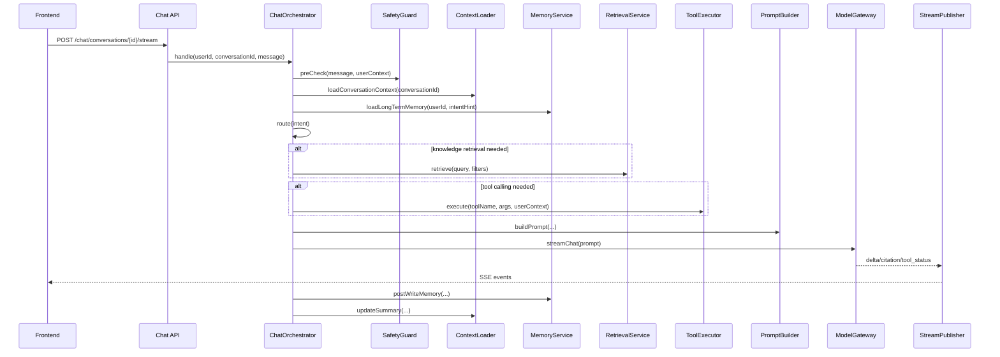
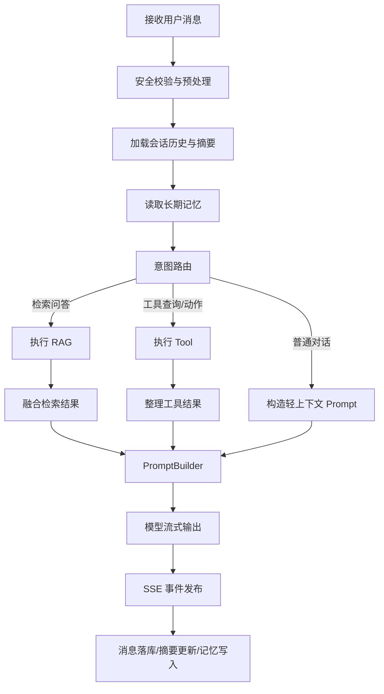
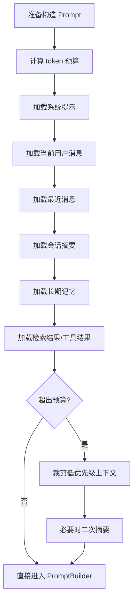

# 04. Agent、RAG、Memory 与上下文管理详细设计

## 0. 文档定位
本文基于以下已有设计文档继续细化：
- [technical-design.md](/d:/BOS/Medora/design/technical-design.md)
- [02-domain-db-design.md](/d:/BOS/Medora/design/02-domain-db-design.md)
- [03-api-contract-design.md](/d:/BOS/Medora/design/03-api-contract-design.md)

本文目标是将 Agent、RAG、Memory、上下文管理细化到可直接指导后续实现的粒度，支持后续直接拆分以下模块：
- `ChatOrchestrator`
- `IntentRouter`
- `RetrievalService`
- `HybridRetriever`
- `RerankService`
- `MemoryService`
- `ConversationSummaryService`
- `PromptBuilder`
- `ToolExecutor`
- `StreamEventPublisher`

本文遵循既有已确认路线：
- 单 Agent + Tool Calling
- PostgreSQL + pgvector + FTS
- 一期优先 SSE
- 一期不做多 Agent
- 一期不引入知识图谱
- 业务系统与 Agent 系统通过 Service/Tool 边界解耦

---

## 1. 设计目标与约束

### 1.1 设计目标
- 将用户问题路由到合适处理链路：普通对话、知识检索、工具调用或组合链路。
- 在保证工程可控的前提下实现可解释、可追踪的 RAG 与 Tool Calling。
- 让短期记忆、长期记忆、会话摘要、上下文压缩具备明确边界和触发条件。
- 保证 Agent 输出受业务规则与安全约束控制，不绕过业务系统。
- 为二期增强检索引擎、rerank、多 Agent、独立 worker 保留接口层抽象。

### 1.2 设计约束
- 一期入口统一为单个对话编排器，不引入多 Agent 协调器。
- 一期模型调用通过 Spring AI 封装的统一 `ModelGateway` 完成。
- 一期知识检索由应用层编排 FTS + 向量召回，不引入外部搜索集群。
- 一期长期记忆以结构化存储为主，不将整段聊天记录直接当作长期记忆。
- 一期 Rerank 不是硬依赖，但必须预留标准接口。
- 所有带副作用动作必须经 Tool 服务进入业务层，不允许模型直接操作数据库。

### 1.3 合理工程假设
- 一期目标模型支持系统提示、流式输出、基本 Tool Calling。
- 一期对“医疗问诊”只做服务引导与规则解释，不做疾病诊断结论。
- 一期知识库主要来源于挂号规则、科室介绍、医生简介、导诊 FAQ。
- 一期中文场景以业务关键词抽取和向量召回结合为主，不强依赖高级中文分词体系。

---

## 2. 整体模块划分

## 2.1 核心模块总览

| 模块 | 主要职责 | 是否一期必做 |
|---|---|---|
| `ChatOrchestrator` | 总编排入口，组织路由、检索、记忆、工具、模型调用 | 是 |
| `IntentRouter` | 判断走普通对话、RAG、Tool Calling 或组合链路 | 是 |
| `SafetyGuard` | 输入安全检查、策略约束、工具权限预检 | 是 |
| `ConversationContextLoader` | 加载当前会话短期上下文与摘要 | 是 |
| `MemoryService` | 长期记忆读取、写入、清理 | 是 |
| `RetrievalService` | 检索统一入口 | 是 |
| `HybridRetriever` | 关键词召回 + 向量召回 + 融合 | 是 |
| `RerankService` | 对候选结果重排 | 否，但预留 |
| `PromptBuilder` | 组装系统提示、上下文、引用、工具结果 | 是 |
| `ToolExecutor` | 执行查询型或动作型工具 | 是 |
| `ModelGateway` | 统一模型调用入口 | 是 |
| `StreamEventPublisher` | 向 SSE 层发事件 | 是 |
| `ConversationSummaryService` | 会话摘要与压缩 | 是 |
| `AgentTraceService` | 记录编排链路与检索/工具轨迹 | 是 |

## 2.2 推荐代码模块结构
建议在后端项目中形成如下结构：

```text
medora-agent
  ├─ application
  │  ├─ ChatApplicationService
  │  ├─ ChatOrchestrator
  │  ├─ IntentRouter
  │  ├─ PromptBuilder
  │  ├─ StreamEventPublisher
  │  └─ AgentTraceService
  ├─ tool
  │  ├─ ToolExecutor
  │  ├─ ToolRegistry
  │  └─ tools/*
  ├─ memory
  │  ├─ MemoryService
  │  ├─ ShortTermMemoryLoader
  │  ├─ LongTermMemoryManager
  │  └─ ConversationSummaryService
  ├─ rag
  │  ├─ RetrievalService
  │  ├─ HybridRetriever
  │  ├─ KeywordRetriever
  │  ├─ VectorRetriever
  │  ├─ RerankService
  │  └─ RetrievalResultAssembler
  ├─ model
  │  ├─ ModelGateway
  │  ├─ ChatModelClient
  │  └─ EmbeddingModelClient
  └─ support
     ├─ SafetyGuard
     ├─ TokenBudgetPlanner
     └─ ContextPruner
```

---

## 3. Agent 整体执行链路

## 3.1 用户问题进入系统后的总链路


## 3.2 编排入口职责
`ChatOrchestrator` 负责：
- 接收用户输入和上下文
- 驱动意图路由
- 决定是否进行知识检索
- 决定是否进行工具调用
- 组装 Prompt
- 驱动模型流式生成
- 控制 SSE 事件输出
- 记录 trace
- 触发后置摘要和记忆写入

`ChatOrchestrator` 不负责：
- 具体数据库事务处理
- 医疗业务规则判断的最终落地
- 知识库切片生产
- 具体检索 SQL 的细节

---

## 4. 路由与处理流程设计

## 4.1 路由目标
将用户问题分为以下主要处理模式：
- 普通对话
- 检索增强问答
- 工具查询
- 工具动作执行
- 组合模式：检索 + 工具 + 回答

## 4.2 路由分类建议

| 模式 | 典型问题 | 是否检索 | 是否工具调用 |
|---|---|---|---|
| `CHAT_ONLY` | “你好”“你是谁” | 否 | 否 |
| `RAG_ONLY` | “挂号规则是什么” | 是 | 否 |
| `TOOL_QUERY` | “帮我查明天呼吸内科号源” | 可选 | 是 |
| `TOOL_ACTION` | “帮我预约明天上午李医生” | 可选 | 是 |
| `HYBRID` | “取消挂号有什么规则，顺便帮我取消刚才那个预约” | 是 | 是 |

## 4.3 路由规则建议

### 走普通对话的场景
- 问候语、闲聊、说明性对话
- 不涉及知识库和业务工具
- 例如：
  - “你好”
  - “你能做什么”
  - “帮我总结一下刚才说了什么”

### 走知识检索的场景
- 用户在问制度、规则、说明类内容
- 问题需要引用可解释来源
- 例如：
  - “挂号可以取消吗”
  - “呼吸内科主要看什么”
  - “普通门诊预约规则是什么”

### 走工具调用的场景
- 用户想查询实时业务事实
- 用户想执行业务动作
- 例如：
  - “帮我看看明天上午还有没有号”
  - “我有哪些预约”
  - “帮我取消上一个预约”

### 走组合模式的场景
- 同时需要规则说明与业务数据
- 同时需要工具结果和解释性回复
- 例如：
  - “帮我查明天的号，并告诉我取消规则”
  - “如果我取消当前预约，会不会影响重新挂号”

## 4.4 路由实现建议
一期不建议单独调用一个分类模型做复杂分类，可采用“轻规则 + 轻量提示判断”的组合：

1. 规则层预判
- 是否包含科室/医生/日期/取消/预约/号源等强业务关键词
- 是否命中 FAQ/规则词，如“规则”“说明”“流程”“可以吗”

2. 轻量意图判断
- 对边界模糊问题，使用一个轻量模型提示做 `intentType` 判定

3. 最终路由决策
- 规则层优先于模型层
- 模型层只做辅助，不作为安全边界

---

## 5. 用户问题处理流程

## 5.1 标准处理步骤
建议标准流程如下：

1. 接收用户问题
2. 预处理与安全检查
3. 加载当前会话上下文
4. 读取短期摘要与长期记忆
5. 判断意图和处理模式
6. 按需执行知识检索
7. 按需执行工具调用
8. 计算 token 预算
9. 组装 Prompt
10. 调用模型流式生成
11. 输出 SSE 事件
12. 保存消息、trace、摘要、记忆更新

## 5.2 关键流程图


---

## 6. RAG 详细流程设计

## 6.1 RAG 模块分层

| 模块 | 职责 |
|---|---|
| `DocumentIngestService` | 文档接入与任务创建 |
| `DocumentParser` | 解析原始文档 |
| `DocumentCleaner` | 文本清洗 |
| `DocumentChunker` | 切分策略 |
| `EmbeddingService` | 向量化 |
| `KeywordRetriever` | FTS 检索 |
| `VectorRetriever` | pgvector 检索 |
| `HybridRetriever` | 混合召回与融合 |
| `RerankService` | 候选重排 |
| `RetrievalResultAssembler` | 结果整形与引用组装 |

## 6.2 文档接入流程
建议后端知识入库流程如下：

1. 管理后台上传文档
2. 文档写入 MinIO
3. 创建 `knowledge_document`
4. 创建 `knowledge_ingest_task`
5. 解析文档
6. 清洗文本
7. 切分切片
8. 生成向量
9. 写入 `knowledge_chunk`
10. 更新 FTS 字段与索引状态
11. 文档状态切换为 `INDEXED`

## 6.3 文档切分策略

### 一期推荐策略
- 标题感知切分
- 段落优先切分
- 长度阈值控制
- overlap 保留上下文连续性

### 切分参数建议
- 中文文本每片 `500-800` 字
- overlap `80-150`
- FAQ 文档按问答单元切
- 制度类文档保留章节路径 `sectionPath`

### 切分输出结构建议
```json
{
  "documentId": "doc_xxx",
  "chunkIndex": 12,
  "sectionPath": "挂号规则 > 取消规则",
  "content": "如需取消挂号，请于就诊前一天完成取消。",
  "metadata": {
    "bizScope": "APPOINTMENT_RULE",
    "departmentTags": ["呼吸内科"]
  }
}
```

## 6.4 向量化策略
- 按切片逐个或批量 embedding
- embedding 模型版本写入 `embeddingModel`
- 不同模型切换时建议重建而不是混用
- embedding 失败不影响文档主记录存在，但会使文档处于非索引完成状态

## 6.5 关键词检索设计
一期基于 PostgreSQL FTS：
- 检索字段：`content_tsv`
- 支持基础关键词召回
- 适用于规则词、科室名、医生名、挂号动作词

### 关键词检索适合命中的场景
- “取消挂号”
- “普通门诊”
- “呼吸内科”
- “主任医师”

## 6.6 向量检索设计
向量检索适用于：
- 自然语言表达不标准
- 同义表达
- 语义近似问题

例如：
- “咳嗽该看什么科”
- “感冒一直咳要挂哪个门诊”

## 6.7 混合检索流程

### 输入
- 用户问题
- 业务场景
- 元数据过滤条件

### 处理步骤
1. query normalize
2. query keyword extract
3. 执行关键词召回
4. 执行向量召回
5. 合并候选结果
6. 去重
7. 按业务规则过滤
8. 可选 rerank
9. 输出 topN

### 伪代码
```java
RetrievalResult retrieve(String query, RetrievalContext context) {
    NormalizedQuery nq = queryPreprocessor.normalize(query, context);

    List<ChunkCandidate> keywordHits =
        keywordRetriever.search(nq.getKeywordQuery(), context.getFilters(), 8);

    List<ChunkCandidate> vectorHits =
        vectorRetriever.search(nq.getSemanticQuery(), context.getFilters(), 8);

    List<ChunkCandidate> merged =
        resultFusionService.merge(keywordHits, vectorHits);

    List<ChunkCandidate> filtered =
        retrievalFilterService.filter(merged, context);

    List<ChunkCandidate> reranked =
        rerankService.isEnabled(context) ? rerankService.rerank(query, filtered) : filtered;

    return retrievalResultAssembler.assemble(reranked, 5);
}
```

## 6.8 检索触发条件

### 必触发
- 命中规则问答意图
- 命中科室/挂号说明类问题
- 需要引用来源的说明类答复

### 可选触发
- 工具结果解释时，需要补规则说明
- 对话上下文不足，但可从知识库补足

### 不触发
- 简单闲聊
- 明确是实时业务查询且不需要知识解释
- 用户问题极短且没有业务/知识特征

## 6.9 召回策略

### 默认召回参数
- keyword topK = 8
- vector topK = 8
- merge 后候选 10-15
- 最终注入 3-6 个高置信片段

### 元数据过滤策略
优先使用：
- `bizScope`
- `departmentTags`
- `doctorTags`
- `publishStatus=PUBLISHED`
- `status=ACTIVE`

## 6.10 结果融合策略
一期建议采用简单稳定的融合：
- 同一切片重复命中时加权提升
- 规则文档优先级可略高于普通说明文档
- 医疗服务问题优先使用业务范围明确的文档

### 融合优先级建议
1. 命中精确规则且有业务范围
2. 同时命中关键词与向量
3. 向量高相似度但规则范围宽泛

## 6.11 Rerank 设计

### 一期策略
- 预留 `RerankService`
- 默认关闭或只在复杂规则问答下启用

### 触发建议
- merge 后候选较多
- 结果相关性分散
- 用户问题复杂、长文本、多约束

### 回退策略
- rerank 服务失败时直接退回融合结果
- rerank 不影响主链路可用性

## 6.12 上下文组装
检索结果不能原样全部注入，建议组装为：
- `title`
- `sourceId`
- `sectionPath`
- `snippet`
- `whySelected`

示例：
```json
{
  "index": 1,
  "title": "挂号规则说明",
  "sourceId": "doc_123",
  "sectionPath": "取消规则",
  "snippet": "如需取消挂号，请于就诊前一天完成取消。"
}
```

---

## 7. 检索触发与回退策略

## 7.1 检索触发判定顺序
建议顺序：
1. 业务强动作词判断
2. 知识规则词判断
3. 上下文场景判断
4. 模型辅助判断

## 7.2 检索失败回退
当出现以下情况时触发回退：
- 无召回结果
- 召回质量极低
- 检索服务异常

### 回退策略
- 若是规则问题：明确告知“未检索到可靠知识依据”
- 若是业务问题：优先走工具查询
- 若二者都不足：进入安全保守回答，不编造

## 7.3 结果不足时的输出策略
模型回答必须遵循：
- 可回答的部分给出事实
- 不确定的部分显式说明
- 能引导到医生/科室/挂号动作时给出下一步建议

---

## 8. Memory 设计

## 8.1 Memory 分层

| 记忆层 | 作用 | 载体 |
|---|---|---|
| 短期记忆 | 当前会话连续性 | 最近消息 + 会话摘要 |
| 长期记忆 | 跨会话偏好与稳定事实 | `user_memory_profile` |
| 业务状态记忆 | 当前未完成业务状态 | `conversation_summary.businessStateJson` |

## 8.2 短期记忆设计

### 组成
- 最近 `N` 轮消息
- 当前会话摘要
- 当前业务状态

### 读取策略
- 每次对话编排都读取
- 优先从缓存读取摘要，失败则回源数据库

### 更新策略
- 用户发送消息后记录
- 模型完成回答后更新 `lastMessageAt`
- 达到摘要触发条件时更新 `conversation_summary`

## 8.3 长期记忆设计

### 适合写入的内容
- 常用科室
- 常用医生偏好
- 常用院区
- 挂号偏好时段
- 明确确认过的服务意图偏好

### 不适合写入的内容
- 一次性闲聊
- 未确认的模型猜测
- 低置信度文本总结
- 大段原始聊天记录

## 8.4 长期记忆读取策略
- 只按意图相关读取，不每次全量注入
- 例如挂号场景读取：
  - 常用科室
  - 常用时段
  - 最近有效预约偏好

### 示例
若用户输入：“帮我挂个号”
- 读取常用科室和常用时段
- 不读取与知识检索无关的偏好

## 8.5 长期记忆写入策略

### 写入触发
- 用户显式确认偏好
- 预约成功
- 多轮重复表述形成高置信偏好

### 写入流程
1. 从当前会话和工具结果抽取候选记忆
2. 对候选项打置信分
3. 过滤未确认项
4. 执行 upsert 写入

### 伪代码
```java
void writeLongTermMemory(UserContext user, ConversationContext conversation, ToolResult toolResult) {
    List<MemoryCandidate> candidates =
        memoryExtractionService.extract(user, conversation, toolResult);

    List<MemoryCandidate> accepted =
        candidates.stream()
            .filter(MemoryCandidate::isStable)
            .filter(MemoryCandidate::isConfirmedByUser)
            .toList();

    memoryRepository.upsertAll(accepted);
}
```

## 8.6 长期记忆更新策略
- 相同 `memoryType + memoryKey` 采用 upsert
- 新值与旧值冲突时：
  - 优先用户最新明确确认值
  - 保留更新时间与置信度

## 8.7 遗忘策略

### 短期记忆
- 通过摘要压缩替代
- 旧消息长期保留用于审计，但不默认注入模型

### 长期记忆
- 低置信长期不用的记录降权
- 达到过期时间后可归档或失效
- 用户可在后续增加“清除记忆”功能

---

## 9. 会话摘要、记忆摘要与上下文压缩

## 9.1 会话摘要目标
- 降低上下文长度
- 保持跨轮连续性
- 保留业务关键状态

## 9.2 摘要触发条件

### 推荐混合触发
- 按轮次：达到 `8-12` 轮
- 按 token 预算：上下文接近预算阈值
- 按业务阶段：预约成功、取消成功、主题切换

## 9.3 会话摘要内容结构
建议包含：
- 当前主题
- 已确认事实
- 未完成事项
- 当前业务状态
- 已执行工具摘要

示例：
```json
{
  "topic": "呼吸内科挂号咨询",
  "confirmedFacts": [
    "用户倾向上午号源"
  ],
  "pendingTasks": [
    "等待用户确认是否预约李医生"
  ],
  "businessState": {
    "lastIntent": "APPOINTMENT_QUERY",
    "lastQueriedDate": "2026-04-23"
  }
}
```

## 9.4 记忆摘要触发条件
长期记忆的摘要化主要用于：
- 合并重复偏好
- 降低冗余
- 提升读取效率

触发建议：
- 同类型记忆达到阈值
- 写入时发现重复或冲突项

## 9.5 上下文压缩流程


---

## 10. Prompt 组装与上下文优先级

## 10.1 Prompt 组成层次
建议按以下顺序组织：
1. 系统提示
2. 安全策略
3. 当前用户输入
4. 当前业务状态
5. 会话摘要
6. 长期记忆
7. 检索结果
8. 工具结果
9. 最近几轮消息

## 10.2 系统提示要点
系统提示必须明确：
- 本系统是医疗服务助手，不输出临床诊断结论
- 优先基于知识与工具结果回答
- 不得编造来源
- 工具调用必须遵守边界
- 不得越权访问他人预约

## 10.3 上下文优先级建议

| 优先级 | 内容 |
|---|---|
| P0 | 系统提示、安全约束、当前用户问题 |
| P1 | 当前业务状态、工具动作结果 |
| P2 | 高置信检索结果 |
| P3 | 会话摘要 |
| P4 | 长期记忆 |
| P5 | 最近消息原文 |

## 10.4 裁剪逻辑

### 优先裁掉
- 冗余历史原始消息
- 低置信长期记忆
- 分数低的检索片段

### 保留优先
- 当前用户问题
- 工具返回的结构化事实
- 高置信引用片段
- 当前业务状态

## 10.5 PromptBuilder 伪代码
```java
Prompt build(ChatRequest request, OrchestrationContext ctx) {
    TokenBudget budget = tokenBudgetPlanner.plan(request, ctx);

    PromptParts parts = new PromptParts();
    parts.addSystem(systemPromptFactory.createBasePrompt());
    parts.addSystem(systemPromptFactory.createSafetyPrompt());
    parts.addUser(request.message());
    parts.addStructured("businessState", ctx.getBusinessState());
    parts.addStructured("conversationSummary", ctx.getConversationSummary());
    parts.addStructured("longTermMemory", contextPruner.pruneMemory(ctx.getLongTermMemory(), budget));
    parts.addStructured("retrievalResults", contextPruner.pruneRetrieval(ctx.getRetrievalResults(), budget));
    parts.addStructured("toolResults", ctx.getToolResults());
    parts.addMessages(contextPruner.pruneRecentMessages(ctx.getRecentMessages(), budget));

    return promptAssembler.assemble(parts);
}
```

---

## 11. Tool Calling 设计

## 11.1 Tool 分类

| 类型 | 示例 | 风险级别 |
|---|---|---|
| 查询型 Tool | 查询科室、医生、号源、预约列表 | 低 |
| 动作型 Tool | 预约、取消预约 | 高 |
| 辅助型 Tool | 检索知识、读取摘要 | 中 |

## 11.2 Tool Calling 边界
- Tool 只能调用应用服务，不直接查库写库
- 动作型 Tool 必须校验用户身份与资源归属
- 高风险动作型 Tool 建议要求明确参数，不依赖模型自行补全关键主参数

## 11.3 Tool 调用策略

### 查询型 Tool
- 可以直接执行
- 结果结构化返回给 PromptBuilder

### 动作型 Tool
- 必须在参数完整时执行
- 参数不完整时先由模型请求补充
- 执行后将结果作为事实注入回答

## 11.4 Tool 失败处理

### 失败类型
- 参数校验失败
- 权限校验失败
- 业务规则失败
- 外部服务失败

### 处理策略
- 查询型 Tool 失败：尽量回退到非动作解释
- 动作型 Tool 失败：明确告诉用户失败原因，不伪造成功
- 系统异常：返回可重试提示

## 11.5 Tool 回退策略
- 规则解释问题可不依赖 Tool，只依赖 RAG
- 实时号源查询 Tool 失败时，不给出过期事实
- 预约/取消 Tool 失败时，不能猜测业务结果，只返回失败和下一步建议

---

## 12. 流式输出中的协作关系

## 12.1 流式输出阶段
建议将流式对话拆分为以下阶段：
1. `message_start`
2. 可选 `tool_status(start)`
3. 可选 `citation`
4. `message_delta`
5. 可选 `tool_status(end)`
6. `message_end`

## 12.2 Agent 与检索、工具、SSE 的协作关系

### 场景 A：纯知识问答
- Agent 判断需要检索
- RetrievalService 检索并返回片段
- PromptBuilder 注入引用
- 模型流式输出
- SSE 同步发送 citation + delta

### 场景 B：号源查询
- Agent 判断需要 Tool
- ToolExecutor 查询号源
- 将结果结构化注入 Prompt
- 模型生成自然语言说明
- SSE 发送 tool_status 和正文

### 场景 C：取消预约
- Agent 先确认参数
- ToolExecutor 执行取消
- 业务服务在单事务内完成取消和回补
- Tool 返回最终事实
- 模型生成确认说明

## 12.3 SSE 事件触发建议

| 阶段 | SSE 事件 |
|---|---|
| 开始编排 | `message_start` |
| 开始检索 | 可选 `tool_status` 或 `debug_status` |
| 检索完成 | `citation` |
| 开始工具查询 | `tool_status` |
| 模型输出中 | `message_delta` |
| 结束 | `message_end` |
| 失败 | `error` |

---

## 13. 核心模块伪代码与调用关系

## 13.1 编排主流程伪代码
```java
public void handleChat(ChatCommand command, StreamEventPublisher stream) {
    OrchestrationContext ctx = new OrchestrationContext();

    safetyGuard.preCheck(command);
    ctx.setConversationContext(conversationContextLoader.load(command.conversationId()));
    ctx.setIntent(intentRouter.route(command, ctx));
    ctx.setLongTermMemory(memoryService.loadRelevantMemory(command.userId(), ctx.getIntent()));

    stream.publishMessageStart(...);

    if (ctx.getIntent().needRetrieval()) {
        RetrievalResult retrievalResult = retrievalService.retrieve(command.message(), ctx.toRetrievalContext());
        ctx.setRetrievalResult(retrievalResult);
        stream.publishCitations(retrievalResult.getCitations());
    }

    if (ctx.getIntent().needTool()) {
        stream.publishToolStatus("start", ctx.getIntent().toolName());
        ToolExecutionResult toolResult = toolExecutor.execute(ctx.getIntent(), command, ctx);
        ctx.addToolResult(toolResult);
        stream.publishToolStatus("end", ctx.getIntent().toolName());
    }

    Prompt prompt = promptBuilder.build(command, ctx);

    modelGateway.streamChat(prompt, delta -> stream.publishDelta(delta));

    conversationService.persistAssistantMessage(...);
    summaryService.maybeSummarize(command.conversationId(), ctx);
    memoryService.postWrite(command.userId(), ctx);
    traceService.record(ctx);

    stream.publishMessageEnd(...);
}
```

## 13.2 RetrievalService 伪代码
```java
public RetrievalResult retrieve(String query, RetrievalContext context) {
    NormalizedQuery nq = queryPreprocessor.normalize(query, context);
    List<ChunkCandidate> keywordHits = keywordRetriever.search(nq.keywordQuery(), context.filters(), 8);
    List<ChunkCandidate> vectorHits = vectorRetriever.search(nq.semanticQuery(), context.filters(), 8);
    List<ChunkCandidate> merged = resultFusionService.merge(keywordHits, vectorHits);
    List<ChunkCandidate> filtered = retrievalFilterService.filter(merged, context);
    List<ChunkCandidate> finalHits = rerankService.tryRerank(query, filtered, context);
    return retrievalResultAssembler.assemble(finalHits, 5);
}
```

## 13.3 MemoryService 伪代码
```java
public RelevantMemory loadRelevantMemory(Long userId, IntentType intentType) {
    List<UserMemoryProfile> profiles = memoryRepository.findByUserIdAndIntent(userId, intentType);
    return memorySelectionService.selectTopProfiles(profiles, intentType);
}

public void postWrite(Long userId, OrchestrationContext ctx) {
    List<MemoryCandidate> candidates = memoryExtractionService.extract(ctx);
    List<MemoryCandidate> accepted = memoryPolicyService.filterAccepted(candidates);
    memoryRepository.upsertAll(accepted);
}
```

## 13.4 ToolExecutor 伪代码
```java
public ToolExecutionResult execute(IntentDecision intent, ChatCommand command, OrchestrationContext ctx) {
    toolPermissionChecker.check(intent, command.userId());
    ToolDefinition tool = toolRegistry.get(intent.toolName());
    ToolArguments args = toolArgumentResolver.resolve(intent, command, ctx);
    toolArgumentValidator.validate(args);
    return tool.execute(args);
}
```

---

## 14. 与服务层、SSE、知识库管理的衔接

## 14.1 与服务层的衔接
建议服务层按如下边界协作：

| Agent 模块 | 依赖服务 |
|---|---|
| `ToolExecutor` | `AppointmentCommandService`, `ScheduleSlotQueryService`, `DoctorQueryService` |
| `RetrievalService` | `KnowledgeSearchRepository` 或 `KnowledgeSearchService` |
| `MemoryService` | `UserMemoryProfileRepository`, `ConversationSummaryRepository` |
| `ConversationSummaryService` | `ConversationService`, `ChatMessageRepository` |

## 14.2 与 SSE 输出层的衔接
建议由 `StreamEventPublisher` 统一对外发布事件，避免：
- Orchestrator 直接拼接 SSE 字符串
- ToolExecutor 自行向控制器写事件

推荐接口：
```java
public interface StreamEventPublisher {
    void publishMessageStart(...);
    void publishToolStatus(...);
    void publishCitation(...);
    void publishDelta(String delta);
    void publishMessageEnd(...);
    void publishError(String code, String message);
}
```

## 14.3 与知识库管理模块的衔接
知识库管理模块负责：
- 文档上传
- 文档发布/下线
- 文档重建
- 检索测试

Agent/RAG 模块依赖知识库管理模块提供的数据结果，但不直接介入文档管理页面逻辑。

推荐边界：
- `AdminKnowledgeController` 只调文档管理服务
- `RetrievalService` 只消费 `PUBLISHED + INDEXED + ACTIVE` 的文档切片

## 14.4 与数据库设计的衔接
- 短期记忆读取依赖 `conversation`、`chat_message`、`conversation_summary`
- 长期记忆依赖 `user_memory_profile`
- RAG 依赖 `knowledge_document`、`knowledge_chunk`
- Tool Calling 最终依赖业务服务访问 `department`、`doctor`、`schedule_slot`、`appointment`

---

## 15. 实现拆分建议

## 15.1 一期优先级

### P0 必须先落
- `ChatOrchestrator`
- `IntentRouter`
- `PromptBuilder`
- `RetrievalService`
- `KeywordRetriever`
- `VectorRetriever`
- `MemoryService`
- `ConversationSummaryService`
- `ToolExecutor`
- `StreamEventPublisher`

### P1 紧随其后
- `RerankService` 占位实现
- `TokenBudgetPlanner`
- `ContextPruner`
- `SafetyGuard`
- `AgentTraceService`

### P2 预留扩展
- Query Rewriter
- 多 Agent Router
- 独立检索 worker
- Knowledge Graph Augmentor

## 15.2 推荐开发顺序
1. 定义 ChatApplicationService 与 SSE 事件模型
2. 实现 IntentRouter 与基础 PromptBuilder
3. 实现 ToolExecutor 与查询型 Tool
4. 实现 RetrievalService 与 HybridRetriever
5. 实现 ConversationSummaryService
6. 实现 MemoryService 的读取与基础写入
7. 加入 AgentTrace 记录
8. 增加 RerankService 占位与 TokenBudgetPlanner

---

## 16. 本文结论
- 一期 Agent 设计核心是“单编排器 + 明确路由 + 可控工具边界 + 可追踪 RAG 链路”。
- RAG 必须围绕混合检索、结果融合、可选 rerank、上下文组装展开，不追求过度复杂化。
- Memory 需要严格区分短期会话上下文与长期用户偏好，避免记忆污染。
- PromptBuilder 和 ContextPruner 是控制质量、成本、时延平衡的关键模块。
- Tool Calling 必须服务于业务事实，不得绕过业务事务边界。
- 按本文拆分后，后续可以直接继续细化：
  - `05-service-application-design.md`
  - `06-sse-event-and-chat-runtime-design.md`
  - 或开始搭建 Agent/RAG/Memory 的应用层骨架代码

