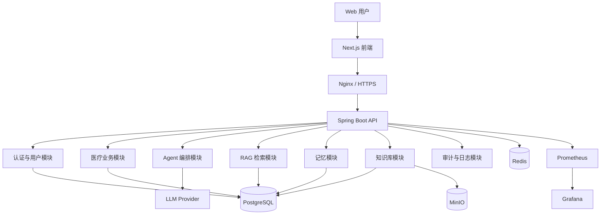
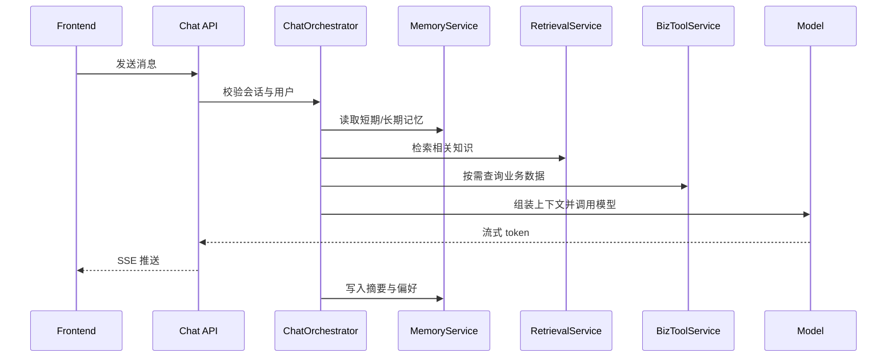
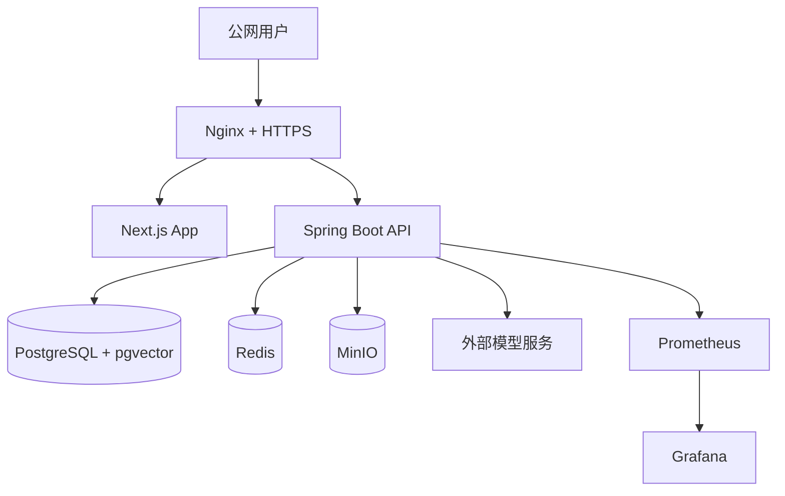

# 项目技术详细设计文档

## 0. 文档说明与工程假设
本文面向后续实际开发落地，目标是为“医疗服务场景的工程化智能助手系统”提供可直接拆任务、可指导实现、可支撑一期上线与二期演进的技术设计基线。

**已确认主路线**
- 一期后端主栈采用 `Java + Spring Boot + Spring AI`
- 一期前端主栈采用 `Next.js + TypeScript + Tailwind CSS + shadcn/ui`
- 一期检索底座采用 `PostgreSQL + pgvector + PostgreSQL Full-Text Search`
- 一期缓存采用 `Redis`
- 一期对象存储采用 `MinIO`
- 一期流式输出采用 `SSE`
- 一期 Agent 采用 `单 Agent + Tool Calling`，不采用多 Agent 编排
- 一期不引入知识图谱，只预留二期增强位

**工程假设**
- 本系统定位为医疗服务助手，不提供临床诊断结论，不替代真实医生诊疗资质。
- 一期目标用户量为中小规模演示与试运行，预计日活低于 1 万，知识文档规模在数千至数万切片以内。
- 一期部署环境按单机轻量云主机设计，推荐起步配置为 `4C8G`，若并发较低可先用 `2C4G` 验证。
- 模型接入层以 OpenAI 兼容接口为主，通过 Spring AI 封装，支持后续切换模型供应商。
- 一期优先保证“业务闭环 + AI 能力可讲述 + 工程化可上线”，不追求一次性做成大而全平台。

---

## 1. 项目背景与建设目标
本项目旨在构建一个面向医疗服务场景的智能助手系统，使用户能够在统一前端中完成导诊辅助、医疗服务知识问答、号源查询、预约挂号、取消挂号、医生与科室查询、历史会话回看等操作，并通过 Agent、RAG、Memory、Streaming 等 AI 工程能力提升系统交互体验与服务效率。

**建设目标**
- 建成一个可公网访问、可部署上线、可演示完整闭环的工程化系统。
- 同时体现传统业务系统能力与 AI 应用架构能力，而非单纯聊天机器人。
- 形成可持续演进的技术底座，使一期实现不过度复杂，二期又能平滑升级。
- 通过模块化单体架构控制个人项目复杂度，并为后续拆分服务预留清晰边界。
- 在安全、审计、监控、部署层面满足真实演示系统的基本要求。

---

## 2. 项目范围与分期规划

### 2.1 一期 MVP 范围
一期聚焦“可展示、可演示、可上线”的最小闭环，范围包括：
- 用户注册、登录、基础资料管理
- 对话页面与 AI 助手能力
- 医疗服务知识问答与引用展示
- 号源查询、医生查询、科室查询
- 预约挂号与取消挂号
- 会话记录、历史问答记录、简化就诊记录
- 知识库文档上传、解析、切分、入库、检索
- 结构化长期记忆与短期会话记忆
- SSE 流式输出
- 管理后台基础能力：知识库管理、会话查看、日志审计查看
- 单机 Docker 化部署

### 2.2 二期演进范围
二期在不推翻一期架构的前提下演进：
- 引入 Elasticsearch 作为独立搜索/向量增强引擎
- 增加 rerank 服务、query rewrite 策略、场景化检索模板
- 引入知识图谱或规则图谱增强挂号规则解释
- 多 Agent 或 Router 机制
- 文档增量重建、知识版本管理、灰度知识发布
- 更精细的 RBAC、租户化能力、运营配置中心
- 独立 worker、消息队列、检索服务拆分
- 更强 observability 与自动告警

---

## 3. 核心业务场景与用户角色
**用户角色**
- 普通用户：发起咨询、查询科室与医生、查看号源、预约挂号、取消挂号、查看历史记录
- 管理员：维护知识库、查看文档解析状态、查看会话与审计日志、调整 Prompt 与检索参数
- 系统服务：负责文档处理、检索、记忆归纳、Agent 编排、业务工具调用

**核心业务场景**
- 用户通过自然语言提问：“我最近咳嗽，应该挂哪个科？”
- 系统结合知识库、科室信息、用户历史偏好返回建议，并给出引用来源
- 用户继续查询某科室医生与号源
- 用户选定时间完成预约挂号
- 用户可在后续对话中取消挂号或查看既往预约记录
- 管理员上传院内规则、挂号说明、科室介绍文档，系统完成解析并纳入检索

---

## 4. 功能需求与非功能需求
**功能需求**
- 用户与认证：注册、登录、登出、用户资料、会话列表、历史问答
- 医疗服务业务：号源查询、医生查询、科室查询、预约挂号、取消挂号、简化就诊记录
- AI 能力：对话、检索增强问答、工具调用、长期记忆、短期记忆、上下文压缩、流式输出
- 知识库：文档上传、解析状态、切片入库、检索验证、版本与重建
- 管理后台：知识库管理、会话管理、日志审计、参数配置预留

**非功能需求**
- 响应体验：普通业务接口 P95 小于 `500ms`，对话首包时间控制在 `2-4s`，流式持续输出
- 可用性：单机部署可稳定运行，核心业务具备幂等控制和失败补偿
- 安全性：JWT 鉴权、接口鉴权、Prompt Injection 防护、工具调用白名单、文档污染防护
- 可观测性：结构化日志、链路 trace id、Agent 调用日志、业务审计日志、基础指标监控
- 可维护性：模块边界清晰、配置化参数、文档化 API、统一错误码
- 可扩展性：支持检索引擎升级、模型切换、Agent 编排升级、服务拆分

---

## 5. 总体技术架构设计

### 5.1 系统总体架构
一期采用“前后端分离 + 模块化单体后端 + 外部基础设施组件”的架构。后端在一个 Spring Boot 工程中按照领域划分模块，避免微服务早拆。



### 5.2 模块划分
后端建议拆分为以下逻辑模块：
- `medora-auth`：认证、用户、JWT、权限校验
- `medora-user`：用户资料、偏好、会话归属
- `medora-biz`：科室、医生、号源、预约、取消、就诊记录
- `medora-chat`：会话、消息、流式响应、对话控制器
- `medora-agent`：Agent 编排、工具路由、意图识别、响应拼装
- `medora-rag`：检索、召回、混合检索、引用组织
- `medora-memory`：短期记忆、长期记忆、摘要压缩、写入与遗忘
- `medora-kb`：文档上传、解析、索引构建、状态管理
- `medora-admin`：后台管理与配置入口
- `medora-observability`：日志、审计、指标、trace 上下文

### 5.3 核心调用链路
**链路 A：AI 对话问答**
- 前端发起对话请求
- API 完成鉴权、会话加载、限流校验
- Agent 根据意图决定是否走检索、记忆、工具调用
- 若为知识问答，触发 RAG 检索并组装引用片段
- 若为业务操作，调用业务工具服务
- 结果经上下文管理器裁剪后送入模型
- 模型输出通过 SSE 流式回传
- 会话消息、审计日志、记忆摘要异步或准异步落库

**链路 B：文档入库**
- 管理员上传文档到 MinIO
- 创建 `knowledge_document` 与 `knowledge_ingest_task`
- 文档解析器读取原文、清洗文本、切片、生成元数据
- 调用 embedding 模型生成向量
- 写入 `knowledge_chunk` 与向量列
- 更新 FTS 字段与索引状态
- 文档变更后触发检索可见状态更新

**链路 C：预约挂号**
- 用户查询科室/医生/号源
- 前端选定号源后调用预约接口
- 业务模块执行库存校验、幂等校验、状态流转
- 写入 appointment 与 audit log
- 返回预约成功信息
- Agent 可在对话中读取最新预约状态用于连续服务

### 5.4 前后端交互方式
- 普通业务接口采用 REST API + JSON
- 对话接口采用 `SSE`
- 文件上传采用 `multipart/form-data`
- 后台表格查询采用 REST 分页接口
- 前端统一携带 `Authorization: Bearer <token>`
- 每个请求附带 `X-Request-Id`，后端透传到日志与审计链路

---

## 6. 技术选型与选型理由

### 6.1 前端技术栈
**设计目标**
- 支撑对话页、后台管理页、挂号业务页
- 兼顾流式交互、现代视觉与开发效率

**当前推荐方案**
- `Next.js + TypeScript + Tailwind CSS + shadcn/ui + TanStack Query`
- 理由：页面组织能力强，组件生态成熟，易做高质量前端；对流式页面与管理后台都适配。

**后续演进方式**
- 若后续要更强实时交互，可增加 WebSocket 通道
- 若需要前端 BFF，可利用 Next.js Route Handlers 做边缘转发层

### 6.2 后端技术栈
**设计目标**
- 以 Java 为核心，兼顾业务系统稳定性与 AI 工程能力

**当前推荐方案**
- `Spring Boot 3.x`
- `Spring Security`
- `Spring Data JPA`
- `Spring AI`
- `Spring Web MVC + SSE`，一期不强制全量 WebFlux
- 理由：Spring 生态完整，Spring AI 已支持向量库、Chat Memory、Tool Calling、Advisors 等核心能力，适合一期收敛实现。

**后续演进方式**
- 对话链路可逐步演进为 `WebFlux`
- Worker 可拆为独立进程
- AI 编排服务可拆为独立子服务

### 6.3 数据库与缓存
**当前推荐方案**
- `PostgreSQL 16+`
- `pgvector`
- `Redis`

**选型理由**
- PostgreSQL 同时承载事务数据、全文检索、向量数据，减少组件数量
- Redis 用于热点缓存、短期会话状态、限流、幂等控制与短期记忆缓存

**后续演进方式**
- 二期可增加 Elasticsearch 作为独立检索引擎
- 长期记忆可拆到独立 memory store

### 6.4 检索与向量能力
**当前推荐方案**
- `PostgreSQL FTS + pgvector + Hybrid Search`
- 使用 `tsvector + GIN` 做关键词检索
- 使用 `vector` 列做向量相似检索
- 应用层完成结果 merge 与得分融合

**选型理由**
- 一期最小化基础设施复杂度
- 文档规模适中时足以支撑医疗服务知识问答与规则解释

**后续演进方式**
- 新增 Elasticsearch 检索适配器
- 加入 rerank 模型与 query expansion

### 6.5 模型接入与 Agent 框架
**当前推荐方案**
- `Spring AI` 统一接入模型
- 模型网关封装 `chat / embedding / moderation / rerank` 能力
- Agent 采用单 Agent + Tool Calling + Retrieval Advisors 模式

**选型理由**
- 业务侧与模型供应商解耦
- 便于后续切换 OpenAI 兼容接口或其他模型服务

**后续演进方式**
- 增加模型路由策略
- 增加多模型 fallback
- 增加独立 rerank 服务与长文本摘要服务

### 6.6 日志监控与部署方案
**当前推荐方案**
- `Micrometer + Prometheus + Grafana`
- 应用日志 JSON 化
- 审计日志单独落表
- `Docker Compose + Nginx`

**后续演进方式**
- 增加 Loki/Tempo
- 增加告警通知渠道
- 增加多环境部署流水线

---

## 7. 核心业务系统设计

### 7.1 用户与认证模块
**设计目标**
- 提供最小完整身份体系，为会话、预约、审计提供主体归属

**当前推荐方案**
- 用户注册支持手机号或邮箱的简化实现
- JWT Access Token + Refresh Token
- 用户资料表与偏好表分离
- Spring Security 负责鉴权，业务侧读取用户上下文

**后续演进方式**
- 二期增加短信验证码、OAuth 登录、RBAC 细粒度权限

### 7.2 预约挂号模块
**设计目标**
- 实现可演示的业务闭环，同时控制医疗真实业务复杂度

**当前推荐方案**
- 预约以“号源库存扣减 + 预约记录创建 + 状态流转”实现
- 状态建议：`INIT`、`CONFIRMED`、`CANCELLED`、`COMPLETED`
- 幂等键避免重复预约
- 预约成功后写审计与会话可读事件

**后续演进方式**
- 二期增加支付预留、候补排队、院区规则、黑名单限制

### 7.3 取消挂号模块
**设计目标**
- 保证取消规则明确、号源回补一致

**当前推荐方案**
- 取消前检查预约状态与时间规则
- 取消成功后回补号源库存
- 记录取消原因和操作者来源
- 对话 Agent 只能通过受控工具取消，不直接写库

**后续演进方式**
- 二期增加更复杂的取消规则与违约限制

### 7.4 号源查询模块
**设计目标**
- 提供支持自然语言和结构化查询的统一号源查询能力

**当前推荐方案**
- 根据科室、医生、日期、时段、状态查询 schedule slot
- 查询接口同时供前端页面与 Agent 工具复用
- Redis 可缓存热点日期的号源结果

**后续演进方式**
- 二期增加聚合查询、推荐排序与搜索引擎同步

### 7.5 医生/科室信息模块
**设计目标**
- 作为 AI 推荐与业务挂号的基础主数据

**当前推荐方案**
- 科室与医生独立建模
- 医生归属科室，可附带职称、简介、擅长方向、出诊计划
- 对外查询接口分页化、支持关键词过滤
- 对 Agent 暴露只读工具接口

**后续演进方式**
- 二期增加医生标签体系、院区维度、排班策略解释

### 7.6 会话记录与审计模块
**设计目标**
- 既支持用户查看历史，也支持安全审计与问题回溯

**当前推荐方案**
- 会话表、消息表、Agent trace 表、业务审计表分离
- 消息内容可保存用户输入、模型输出、引用片段、工具调用记录
- 敏感信息按规则脱敏后写日志

**后续演进方式**
- 二期增加完整 trace UI、SLO 分析、问题会话回放

---

## 8. AI Agent 系统设计

### 8.1 Agent 架构模式
**设计目标**
- 在复杂度可控的前提下实现对话、检索、工具调用统一编排

**当前推荐方案**
- 单 Agent 主控
- 通过意图识别决定三条主链路：纯问答、检索增强问答、业务工具调用
- Spring AI Advisors 负责补充检索上下文、记忆上下文和系统约束

**为什么这样设计**
- 单 Agent 足以支撑一期场景
- 比多 Agent 更稳定、更容易调试、更容易审计

**后续演进方式**
- 二期增加 Router，将导诊、知识问答、业务办理拆为子 Agent

### 8.2 Tool Calling 与工具边界
**设计目标**
- 确保 Agent 能调用业务能力，但不能越过业务规则和权限控制

**当前推荐方案**
- 工具只暴露 application service，不暴露 repository
- 工具分类：查询类工具、业务动作类工具、知识辅助类工具
- 高风险动作必须二次参数确认，例如取消挂号
- 每个工具定义输入 schema、权限检查、审计记录

**工具清单建议**
- `queryDepartments`
- `queryDoctors`
- `queryScheduleSlots`
- `bookAppointment`
- `cancelAppointment`
- `getUserAppointments`
- `searchKnowledge`
- `getConversationSummary`

**后续演进方式**
- 二期引入工具路由白名单、场景策略模板、人工审核点

### 8.3 会话编排与任务路由
**当前推荐方案**
- 入口统一为 `ChatOrchestrator`
- 处理步骤：
  1. 读取用户与会话上下文
  2. 执行安全过滤与意图判断
  3. 选择是否检索知识
  4. 选择是否加载记忆
  5. 选择是否调用业务工具
  6. 构造 Prompt 与上下文
  7. 流式生成响应
  8. 后置持久化与摘要写入



### 8.4 与业务系统解耦设计
**当前推荐方案**
- Agent 不直接依赖业务数据库
- Agent 只依赖工具接口与查询接口
- 业务域负责校验规则、事务边界、状态流转
- Agent 域负责用户表达理解与编排

**后续演进方式**
- 二期可独立部署 Agent 服务，业务系统对外提供内部 API 或 RPC

---

## 9. RAG 详细设计

### 9.1 知识源与文档接入
**设计目标**
- 构建可持续更新、可审计、可回溯的知识底座

**当前推荐方案**
- 接入文档类型：PDF、DOCX、Markdown、纯文本、后台录入规则
- 文档先上传至 MinIO，再由后台任务解析
- 文档来源分级：官方制度文档、科室说明、医生简介、挂号规则、FAQ
- 每份文档必须有来源、版本、状态、发布时间、适用范围

**后续演进方式**
- 二期增加网页抓取、定时同步、知识灰度发布

### 9.2 文档清洗与切分策略
**设计目标**
- 提高召回质量，减少噪音切片

**当前推荐方案**
- 先做文本清洗：去页眉页脚、去无意义空白、去重复页码、保留标题层级
- 切分采用“标题感知 + 长度阈值”策略
- 推荐切片长度：`500-800` 中文字级或近似 token 规模
- overlap 建议：`80-150`
- 对规则型文档优先保持段落完整，不强行等长切分
- 对 FAQ 型文档优先按问答单元切分

**为什么这样设计**
- 医疗服务规则和挂号说明常带结构层级，纯定长切分会破坏语义边界

**后续演进方式**
- 二期增加语义切分、结构化问答抽取、章节摘要

### 9.3 元数据设计
**设计目标**
- 支撑高质量过滤、解释性和未来搜索引擎迁移

**当前推荐方案**
- 文档级元数据：`document_id`、`title`、`source_type`、`source_uri`、`biz_scope`、`department_tags`、`doctor_tags`、`version`、`published_at`
- 切片级元数据：`chunk_id`、`chunk_index`、`section_path`、`content_hash`、`embedding_model`、`language`、`status`
- 检索时优先利用 `biz_scope`、`department_tags`、`doctor_tags` 做过滤

**后续演进方式**
- 二期增加院区、租户、有效期、知识可信度评分

### 9.4 向量化与索引构建
**设计目标**
- 保证切片可检索、可重建、可版本化

**当前推荐方案**
- 解析成功后写入任务表
- embedding 任务批量生成向量并写入 `vector` 列
- 为 `tsvector` 建 `GIN` 索引
- 为向量列建立 `ivfflat` 或按 pgvector 支持的近似索引策略
- 文档状态流转建议：`UPLOADED`、`PARSED`、`CHUNKED`、`EMBEDDED`、`INDEXED`、`FAILED`

**后续演进方式**
- 二期增加异步 worker 队列、重试机制、双索引写入 ES

### 9.5 关键词检索、向量检索、混合检索
**设计目标**
- 一期实现务实且有工程价值的混合检索

**当前推荐方案**
- Query 预处理：清洗停用词、提取医生/科室/业务动作关键词
- 关键词检索：基于 PostgreSQL FTS
- 向量检索：基于 pgvector 相似度
- 混合策略：各自召回 `topK`，应用层做 normalize 与 merge
- 推荐配置：关键词 `topK=8`，向量 `topK=8`，合并后进入后续筛选

**为什么这样设计**
- 医疗服务问答既有规则词精确匹配需求，也有语义表达差异

**后续演进方式**
- 二期增加 query rewrite、多路召回、场景化权重

### 9.6 Rerank 设计
**设计目标**
- 在成本与质量之间取得平衡

**当前推荐方案**
- 一期不把 rerank 设为硬依赖
- 默认策略：对 merge 结果做规则过滤后直接选前 N
- 预留 `RerankService` 接口与配置开关
- 可在高价值场景或低命中质量场景下手动开启 rerank

**为什么这样设计**
- 一期系统复杂度与成本优先，先把混合召回打稳更重要

**后续演进方式**
- 二期接入独立 rerank 模型，对 top 20 做重排

### 9.7 检索结果组织与 Prompt 注入
**设计目标**
- 让模型知道“能说什么、不能说什么、引用来自哪里”

**当前推荐方案**
- 将检索结果按主题聚合，最多注入 `3-6` 个高置信切片
- 每个切片带来源标题和文档标识
- 系统提示中加入：
  - 不得编造医疗诊断结论
  - 优先引用已检索内容
  - 若知识不足，明确说明并引导用户查询医生/科室
- 回答中支持引用标记，例如 `[1][2]`

**后续演进方式**
- 二期引入 evidence scoring、片段聚类、引用高亮

### 9.8 知识更新与重建机制
**设计目标**
- 支撑文档修改、失效、回滚和局部重建

**当前推荐方案**
- 文档以版本化方式管理，不直接覆盖历史
- 更新后新版本文档重新切片并建立新索引
- 激活版本切换后，旧版本标记为非检索可见
- 使用 `content_hash` 判断切片是否变化，支持局部重建预留

**后续演进方式**
- 二期实现增量索引、灰度发布、ES 双写同步

---

## 10. 记忆系统设计

### 10.1 短期记忆设计
**设计目标**
- 维持当前会话连续性，避免重复询问与上下文丢失

**当前推荐方案**
- 短期记忆以“当前会话最近若干轮消息 + 会话摘要”构成
- 热数据可缓存在 Redis
- 权威落库在 PostgreSQL `conversation_summary` 与 `chat_message`
- 对话编排时优先读取本会话最近 `N` 轮与最新摘要

**后续演进方式**
- 二期加入更细粒度的对话状态机和上下文分段缓存

### 10.2 长期记忆设计
**设计目标**
- 跨会话保存用户偏好和稳定信息，提升连续服务能力

**当前推荐方案**
- 长期记忆以结构化为主，不直接把整段自由文本都当记忆
- 典型内容：常查科室、常用院区、挂号偏好、近期意图、特殊提醒
- 存储在 PostgreSQL `user_memory_profile`、`user_preference` 等表
- 对高价值摘要型记忆可附加向量化字段预留，但一期不强依赖

**为什么这样设计**
- 结构化记忆可控、可审计、污染更少

**后续演进方式**
- 二期引入向量化长期记忆召回或独立 memory store

### 10.3 记忆写入、读取、更新、遗忘策略
**当前推荐方案**
- 写入触发：会话结束、跨轮重复偏好确认、业务动作完成后
- 读取触发：新会话启动、相关业务意图命中、用户显式提及历史偏好
- 更新策略：同类偏好按最新可信值覆盖或累积分值
- 遗忘策略：短期摘要定期 compaction，长期低置信记忆定期清理或降权

### 10.4 记忆污染控制
**当前推荐方案**
- 只对“稳定、可复用、用户明确表达”的信息写长期记忆
- 模型推断但用户未确认的信息不进入长期记忆
- 业务事实优先于模型总结
- 每条记忆记录保留 `source_type`、`confidence_score`、`confirmed_by_user`

### 10.5 记忆与 RAG 的边界
**边界原则**
- RAG 回答“公共知识、制度规则、科室医生信息”
- Memory 回答“这个用户的稳定偏好、历史上下文、连续服务线索”
- 两者不能互相替代
- Memory 不应成为知识库
- 知识库不应存储用户私域偏好

---

## 11. 上下文窗口管理与自动压缩设计

### 11.1 上下文分层
上下文建议分四层：
- 层 1：系统提示与安全约束
- 层 2：当前轮用户输入与业务状态
- 层 3：短期会话上下文与最近消息
- 层 4：检索结果、长期记忆与工具输出

### 11.2 压缩触发条件
**当前推荐方案：混合触发**
- 按 token 阈值触发：接近模型上下文预算时触发
- 按轮次触发：例如每 `8-12` 轮触发一次摘要
- 按业务阶段触发：预约完成、取消完成、主题切换时触发
- 优先推荐混合触发，不建议只按轮次或只按 token

### 11.3 历史摘要策略
**当前推荐方案**
- 摘要分为“会话摘要”和“业务摘要”
- 会话摘要记录当前主题、关键事实、未完成事项
- 业务摘要记录预约结果、取消结果、用户确认的偏好
- 摘要替代旧消息而不是无限附加
- 摘要生成后保留最近 `3-5` 轮原始消息作为精细上下文

### 11.4 Token、质量、时延的平衡
**当前推荐方案**
- 控制注入的切片数和记忆项数量
- 工具输出进入模型前先做结构化压缩
- 长文本知识片段优先抽取摘要句与引用句
- 对高频查询场景使用模板化回答骨架
- 一期先保守配置，优先保证首包速度和稳定性

---

## 12. 流式输出与前端交互设计

### 12.1 后端流式返回方案
**设计目标**
- 提供连续输出体验，降低等待焦虑

**当前推荐方案**
- 使用 `SSE`
- 后端按事件类型发送：
  - `message_start`
  - `message_delta`
  - `citation`
  - `tool_status`
  - `message_end`
  - `error`
- 对话首包前先返回 `message_start`
- 若触发工具调用，可先推送阶段状态

### 12.2 前端流式渲染方案
**当前推荐方案**
- 使用 EventSource 或 fetch stream 封装
- 对 `message_delta` 做逐字或逐句拼接
- 引用片段独立区域展示，并与正文引用编号同步
- 工具调用状态用时间线或标签展示
- 中间状态要可见，例如“正在检索知识”“正在查询号源”

### 12.3 中断、重试、异常处理
**当前推荐方案**
- 用户主动中断时，前端关闭 SSE，后端记录中断状态
- 网络波动时前端允许重试，但重试不重复执行业务动作
- 对带副作用工具调用必须使用幂等键
- 若模型调用失败，保留已生成片段并提示重新生成

### 12.4 引用片段与状态同步展示
**当前推荐方案**
- 每次 citation 事件携带 `source_id`、`title`、`snippet`
- 前端引用面板可点击展开原片段
- 工具调用结果与引用分区展示，避免用户混淆“知识依据”和“业务查询结果”

---

## 13. 数据库设计

### 13.1 核心实体分析
核心实体包括：
- 用户与认证：`user_account`、`user_profile`、`refresh_token`
- 医疗业务：`department`、`doctor`、`schedule_slot`、`appointment`、`visit_record`
- 会话与审计：`conversation`、`chat_message`、`agent_trace`、`audit_log`
- 知识库：`knowledge_document`、`knowledge_chunk`、`knowledge_ingest_task`
- 记忆：`conversation_summary`、`user_memory_profile`
- 配置预留：`system_config`

### 13.2 核心表设计
以下为核心表建议字段摘要。

**`user_account`**
- `id`
- `username`
- `mobile`
- `email`
- `password_hash`
- `status`
- `created_at`
- `updated_at`

**`user_profile`**
- `user_id`
- `display_name`
- `gender`
- `birth_date`
- `default_hospital`
- `default_department`
- `preferences_json`

**`department`**
- `id`
- `name`
- `code`
- `description`
- `tags`
- `status`

**`doctor`**
- `id`
- `department_id`
- `name`
- `title`
- `specialty`
- `intro`
- `status`

**`schedule_slot`**
- `id`
- `doctor_id`
- `department_id`
- `schedule_date`
- `time_period`
- `total_quota`
- `available_quota`
- `fee`
- `status`

**`appointment`**
- `id`
- `user_id`
- `slot_id`
- `appointment_no`
- `status`
- `booked_at`
- `cancelled_at`
- `cancel_reason`
- `source_channel`

**`conversation`**
- `id`
- `user_id`
- `title`
- `status`
- `last_message_at`
- `created_at`

**`chat_message`**
- `id`
- `conversation_id`
- `role`
- `content`
- `message_type`
- `tool_call_json`
- `citation_json`
- `token_usage_json`
- `created_at`

**`conversation_summary`**
- `conversation_id`
- `summary_text`
- `business_state_json`
- `summary_version`
- `updated_at`

**`user_memory_profile`**
- `id`
- `user_id`
- `memory_type`
- `memory_key`
- `memory_value`
- `confidence_score`
- `confirmed_by_user`
- `source_type`
- `last_used_at`

**`knowledge_document`**
- `id`
- `title`
- `source_type`
- `source_uri`
- `biz_scope`
- `department_tags`
- `doctor_tags`
- `version`
- `status`
- `content_hash`
- `uploaded_at`

**`knowledge_chunk`**
- `id`
- `document_id`
- `chunk_index`
- `section_path`
- `content`
- `content_tsv`
- `embedding vector`
- `embedding_model`
- `metadata_json`
- `status`

**`knowledge_ingest_task`**
- `id`
- `document_id`
- `task_type`
- `status`
- `retry_count`
- `error_message`
- `started_at`
- `finished_at`

**`agent_trace`**
- `id`
- `conversation_id`
- `message_id`
- `intent_type`
- `retrieval_json`
- `tool_events_json`
- `latency_ms`
- `status`

**`audit_log`**
- `id`
- `user_id`
- `action_type`
- `resource_type`
- `resource_id`
- `request_id`
- `detail_json`
- `created_at`

### 13.3 表关系设计
- `user_account 1:1 user_profile`
- `department 1:N doctor`
- `doctor 1:N schedule_slot`
- `user_account 1:N appointment`
- `schedule_slot 1:N appointment`
- `user_account 1:N conversation`
- `conversation 1:N chat_message`
- `conversation 1:1 conversation_summary`
- `knowledge_document 1:N knowledge_chunk`
- `knowledge_document 1:N knowledge_ingest_task`

### 13.4 索引设计
**事务类索引**
- `user_account.mobile` 唯一索引
- `user_account.email` 唯一索引
- `appointment.user_id + booked_at desc`
- `appointment.slot_id + status`
- `schedule_slot.department_id + schedule_date`
- `schedule_slot.doctor_id + schedule_date`

**检索类索引**
- `knowledge_chunk.content_tsv` 上 `GIN`
- `knowledge_chunk.embedding` 上 `pgvector` 索引
- `knowledge_document.biz_scope`
- `knowledge_document.status`
- `knowledge_chunk.document_id + chunk_index`

**会话类索引**
- `conversation.user_id + last_message_at desc`
- `chat_message.conversation_id + created_at`
- `user_memory_profile.user_id + memory_type + memory_key`

### 13.5 后续扩展字段预留
- 多院区字段
- 租户字段
- 知识生效时间与失效时间
- 检索评分字段
- ES 同步状态字段
- rerank 分数与来源模型字段

---

## 14. API 设计

### 14.1 认证相关接口
- `POST /api/v1/auth/register`
- `POST /api/v1/auth/login`
- `POST /api/v1/auth/refresh`
- `POST /api/v1/auth/logout`
- `GET /api/v1/users/me`
- `PUT /api/v1/users/me`

### 14.2 业务相关接口
- `GET /api/v1/departments`
- `GET /api/v1/doctors`
- `GET /api/v1/doctors/{id}`
- `GET /api/v1/schedule-slots`
- `POST /api/v1/appointments`
- `POST /api/v1/appointments/{id}/cancel`
- `GET /api/v1/appointments`
- `GET /api/v1/visit-records`

### 14.3 对话/Agent 相关接口
- `POST /api/v1/chat/conversations`
- `GET /api/v1/chat/conversations`
- `GET /api/v1/chat/conversations/{id}/messages`
- `POST /api/v1/chat/conversations/{id}/stream`
- `POST /api/v1/chat/conversations/{id}/stop`
- `GET /api/v1/chat/conversations/{id}/summary`

### 14.4 知识库相关接口
- `POST /api/v1/admin/knowledge/documents/upload`
- `GET /api/v1/admin/knowledge/documents`
- `GET /api/v1/admin/knowledge/documents/{id}`
- `POST /api/v1/admin/knowledge/documents/{id}/rebuild`
- `POST /api/v1/admin/knowledge/documents/{id}/publish`
- `POST /api/v1/admin/knowledge/search/test`

### 14.5 管理后台相关接口
- `GET /api/v1/admin/conversations`
- `GET /api/v1/admin/audit-logs`
- `GET /api/v1/admin/agent-traces`
- `GET /api/v1/admin/system-config`
- `PUT /api/v1/admin/system-config`

**统一响应结构**
```json
{
  "code": 0,
  "message": "success",
  "data": {},
  "requestId": "req_xxx"
}
```

**流式事件结构建议**
```json
{
  "event": "citation",
  "data": {
    "index": 1,
    "title": "挂号规则说明",
    "sourceId": "doc_123",
    "snippet": "普通门诊预约需提前一天..."
  }
}
```

---

## 15. 安全设计

### 15.1 鉴权与权限控制
**当前推荐方案**
- JWT Access Token + Refresh Token
- 管理后台接口与普通用户接口分角色鉴权
- 工具调用前再次校验用户身份与资源归属
- 高风险业务动作记录 request id 和 operator id

### 15.2 隐私保护与敏感信息处理
**当前推荐方案**
- 手机号、邮箱、身份证类字段日志脱敏
- 会话内容在日志中只保留摘要或脱敏版本
- 密码采用强哈希
- MinIO 文档不直接公网暴露，采用服务端签名下载或内网读取

### 15.3 Prompt Injection / 越权工具调用防护
**当前推荐方案**
- 系统提示显式限制模型不得绕过工具边界
- 工具白名单由服务端控制，不由模型动态决定工具集
- 工具输入参数进行 schema 校验
- 带副作用工具必须走业务规则校验与幂等检查
- 模型输出不可直接作为 SQL、脚本或下游命令执行

### 15.4 恶意文档与知识污染防护
**当前推荐方案**
- 文档上传限制格式、大小、来源角色
- 文档入库前保留原文与解析文本，支持人工审查
- 可信度低的文档不进入默认检索域
- 对文档内容进行基本清洗，过滤提示注入式语句和异常模板内容
- 知识发布需有显式状态切换，不允许上传即生效

### 15.5 审计与可追踪性
**当前推荐方案**
- 所有登录、预约、取消、知识发布、配置修改、工具调用均审计
- 对话链路保留 request id、conversation id、message id、agent trace id
- 问答结果可追溯到知识片段来源和工具调用记录

---

## 16. 日志、监控与可观测性设计

### 16.1 应用日志
- 统一 JSON 日志
- 字段包含 `timestamp`、`level`、`service`、`requestId`、`userId`、`conversationId`
- 区分 access log、app log、error log

### 16.2 业务日志
- 预约成功、取消成功、号源不足、登录失败、知识发布等事件单独记录
- 业务日志既写应用日志也写审计表

### 16.3 Agent 调用链日志
- 记录意图分类结果
- 记录检索耗时与召回数量
- 记录工具调用顺序、参数摘要、结果摘要
- 记录模型耗时、token 用量、首包时间、总耗时

### 16.4 指标监控与告警建议
**建议指标**
- HTTP QPS、错误率、P95 延迟
- SSE 首包时间与平均会话时长
- 模型调用失败率
- 检索阶段耗时与命中率
- 文档解析失败率
- 预约成功率、取消成功率
- Redis 命中率、PostgreSQL 连接池状态

**告警建议**
- API 5xx 持续升高
- 模型调用连续失败
- 文档入库任务堆积
- PostgreSQL 连接池耗尽
- MinIO 不可用
- 预约接口异常率过高

---

## 17. 部署架构设计

### 17.1 一期最小可行部署架构
**当前推荐方案**
- 单台云主机运行：
  - `Nginx`
  - `Next.js`
  - `Spring Boot API`
  - `PostgreSQL + pgvector`
  - `Redis`
  - `MinIO`
  - `Prometheus`
  - `Grafana`



### 17.2 Docker 化方案
建议使用 `docker-compose.yml` 管理服务，至少包含：
- `nginx`
- `frontend`
- `backend`
- `postgres`
- `redis`
- `minio`
- `prometheus`
- `grafana`

注意事项：
- PostgreSQL 与 MinIO 挂载持久卷
- 环境变量分离为 `.env`
- 后端通过 profile 区分 `dev/test/prod`

### 17.3 Nginx / HTTPS / 域名 / 反向代理
**当前推荐方案**
- Nginx 负责：
  - HTTPS 终止
  - 静态资源转发
  - API 反向代理
  - SSE 长连接代理配置
- 证书可使用 Let’s Encrypt
- SSE 要关闭代理缓冲或单独调整超时与缓冲策略

### 17.4 前后端部署策略
- 前端以独立容器运行，构建产物由 Node runtime 承载
- 后端以单一 API 容器运行
- 一期文档解析任务可先内嵌在后端进程中，以异步任务方式执行
- 二期再拆独立 worker

### 17.5 成本与资源规划
**起步资源建议**
- 最低可行：`2C4G`
- 推荐起步：`4C8G`
- PostgreSQL 存储建议独立卷 `50G+`
- MinIO 存储按文档量预留 `20G+`

**成本控制策略**
- 一期不自建复杂检索集群
- 一期不引入消息队列
- 模型调用做限流与缓存
- 对高频知识问答可缓存摘要结果

---

## 18. 关键设计结论与实施原则
- 一期采用模块化单体，不做微服务。
- 一期采用 `PostgreSQL + pgvector + FTS`，不引入 Elasticsearch。
- 一期采用单 Agent + Tool Calling，不做多 Agent。
- 一期不引入知识图谱，只预留演进位。
- 业务系统与 Agent 系统通过工具接口解耦。
- Memory 与 Chat History 分离建模。
- 上下文压缩采用“按 token 阈值 + 按轮次 + 按业务阶段”的混合触发。
- SSE 是一期最优的流式方案。
- 所有关键模块以“配置化 + 可替换适配层”设计，为二期升级留口。

---

## 19. 后续开发拆分建议
按实现顺序建议拆为以下里程碑：
1. 基础工程骨架、鉴权、数据库、统一响应与日志框架
2. 科室/医生/号源/预约/取消业务闭环
3. 会话与消息模型、SSE 流式对话基础链路
4. 知识库上传、解析、切片、pgvector + FTS 检索
5. Agent 编排、工具调用、引用展示
6. 记忆与上下文压缩
7. 管理后台与可观测性
8. 安全加固、部署脚本、联调与演示打磨

---

## 20. 官方资料锚点
以下资料用于本设计中的关键技术判断与后续实现核验：
- Spring AI Vector DBs: https://docs.spring.io/spring-ai/reference/api/vectordbs.html
- Spring AI PGvector: https://docs.spring.io/spring-ai/reference/api/vectordbs/pgvector.html
- Spring AI Chat Memory: https://docs.spring.io/spring-ai/reference/api/chat-memory.html
- Spring AI Tools: https://docs.spring.io/spring-ai/reference/api/tools.html
- Spring AI RAG: https://docs.spring.io/spring-ai/reference/api/retrieval-augmented-generation.html
- Next.js App Router: https://nextjs.org/docs/app
- Next.js Route Handlers: https://nextjs.org/docs/app/building-your-application/routing/route-handlers
- OpenAI Streaming: https://platform.openai.com/docs/guides/streaming-responses
- PostgreSQL Full Text Search: https://www.postgresql.org/docs/current/textsearch.html
- Redis Key Expiration: https://redis.io/docs/latest/develop/use/keyspace/
- MinIO Documentation: https://min.io/docs/minio/linux/index.html
