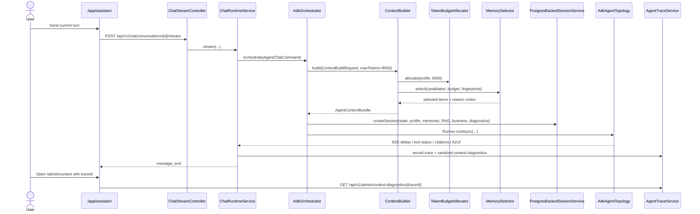

# Context Builder sequence

`FEATURE_CONTEXT_BUILDER=true` activates this path before every ADK run.

The diagnostic endpoint returns profile, budget, source/reason counts, fingerprints, and degradation state. It deliberately does not return raw memory or conversation text.
