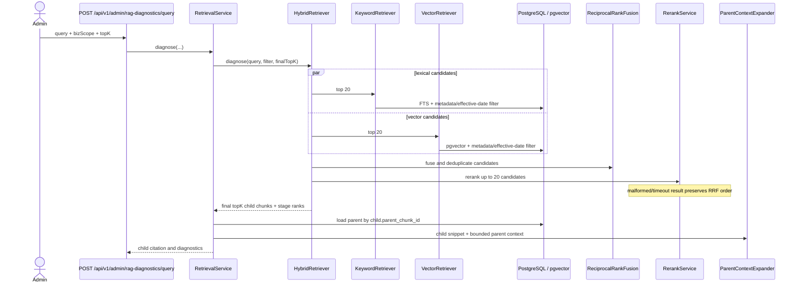

# Layered RAG sequence

The child chunk remains the citation target. Parent text expands the prompt context but does not replace the child identity. In the local application configuration, `NoopReranker` is the default bean; `LlmReranker` fallback behavior is contract-tested and can be wired to a real provider without changing `HybridRetriever`.
